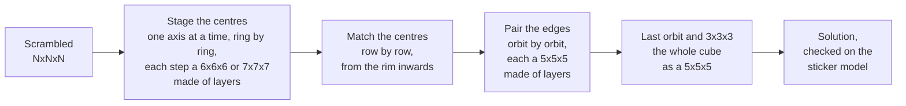

# cubenxnxn

A Rubik's cube solver in Rust for cubes of **any size**, built to find
**short solutions in seconds**. It is measured on every size from 2x2x2 to
21x21x21, the largest cube that is mass-produced.

- **2x2x2 and 3x3x3**: optimal solutions (always for 2x2x2, with `--mode full`
  for 3x3x3), or a two-phase solution in a fraction of a second.
- **4x4x4 to 7x7x7**: a solver written for each size, tuned for length.
- **8x8x8 and up**: one general solver that does not know the size. It treats
  groups of layers as smaller cubes and reuses the solvers above.
- Every solution is applied to a full model of the cube and checked before it
  is printed.

The project is young and under active work: each release gets a row in the
table below, so the progress can be followed.

## Results

Mean number of moves and seconds per cube, by release. Moves are counted in
OBTM (any turn of a face, with any number of layers, is one move).

<!-- releases:begin -->
Release **v0.1.0** (commit `b2f038a`, 2026-11-11), default mode:

| Cube | Moves | Seconds | Longest | Memory | Cubes |
|---|---:|---:|---:|---:|---:|
| 2x2x2 | 8.79 | 0.00 | 0.00 | 6 MB | 100 |
| 3x3x3 | 19.03 | 0.22 | 0.42 | 77 MB | 100 |
| 4x4x4 | 40.71 | 2.8 | 3.8 | 3.0 GB | 100 |
| 5x5x5 | 67.75 | 0.58 | 2.5 | 2.9 GB | 200 |
| 6x6x6 | 108.85 | 8.4 | 10.8 | 3.7 GB | 20 |
| 7x7x7 | 152.75 | 3.8 | 4.7 | 4.0 GB | 20 |
| 8x8x8 | 235.65 | 12.9 | 23.4 | 4.4 GB | 20 |
| 9x9x9 | 314.65 | 3.7 | 12.7 | 4.1 GB | 20 |
| 10x10x10 | 406.05 | 16.6 | 32.7 | 5.3 GB | 20 |
| 11x11x11 | 510.40 | 7.5 | 13.1 | 3.7 GB | 5 |
| 12x12x12 | 619.80 | 21.7 | 28.0 | 4.4 GB | 5 |
| 13x13x13 | 757.80 | 15.8 | 24.2 | 4.0 GB | 5 |
| 14x14x14 | 888.40 | 30.4 | 36.9 | 4.3 GB | 5 |
| 15x15x15 | 1031.80 | 21.4 | 29.0 | 4.3 GB | 5 |
| 16x16x16 | 1185.60 | 40.3 | 45.6 | 4.1 GB | 5 |
| 17x17x17 | 1392.00 | 37.0 | 75.5 | 4.1 GB | 5 |
| 18x18x18 | 1548.00 | 45.8 | 59.8 | 4.1 GB | 5 |
| 19x19x19 | 1763.80 | 49.5 | 72.7 | 3.9 GB | 5 |
| 20x20x20 | 1938.60 | 56.5 | 87.8 | 4.2 GB | 5 |
| 21x21x21 | 2254.00 | 84.2 | 135 | 3.8 GB | 5 |

Every release, the newest first: a row of mean moves and a row of mean seconds per cube.

| Release | | 2 | 3 | 4 | 5 | 6 | 7 | 8 | 9 | 10 | 11 | 12 | 13 | 14 | 15 | 16 | 17 | 18 | 19 | 20 | 21 |
|---|---|---:|---:|---:|---:|---:|---:|---:|---:|---:|---:|---:|---:|---:|---:|---:|---:|---:|---:|---:|---:|
| **v0.1.0** | moves | 8.8 | 19.0 | 40.7 | 67.8 | 108.8 | 152.8 | 235.7 | 314.6 | 406.1 | 510.4 | 619.8 | 757.8 | 888.4 | 1031.8 | 1185.6 | 1392.0 | 1548.0 | 1763.8 | 1938.6 | 2254.0 |
| | seconds | 0.00 | 0.22 | 2.8 | 0.58 | 8.4 | 3.8 | 12.9 | 3.7 | 16.6 | 7.5 | 21.7 | 15.8 | 30.4 | 21.4 | 40.3 | 37.0 | 45.8 | 49.5 | 56.5 | 84.2 |
<!-- releases:end -->

How to read it:

- Measured on an Apple M1 Pro (10 cores, 16 GB) with the default mode of
  every size, on the fixed scrambles in `bench/` (random moves; the "Cubes"
  column says how many).
- Seconds are per cube, with the lookup tables already made; "Longest" is the
  slowest cube.
- Memory is the most the whole run held at once, lookup tables included.
- Two runs of the same release differ a little on the large cubes, a few
  moves on one cube: the searches run on all cores and not every one of
  them is repeatable yet.
- A release is measured with `scripts/release.py measure <name>` and the
  tables are written with `scripts/release.py readme`; the numbers are kept
  in `bench/releases.tsv`.

How this compares with other solvers on the same scrambles is in
[`bench/README.md`](bench/README.md).

## Install

Rust is all it needs ([rustup.rs](https://rustup.rs)):

```bash
cargo build --release
```

**The first solve of a size builds its lookup tables**, once, into `tables/`
(set `CUBENXNXN_TABLES` to put them elsewhere). The 2x2x2 and 3x3x3 need a few
megabytes and a moment; the 4x4x4 about four minutes and 4.9 GB; every size
together about 8.5 GB. See [Tables](#tables).

## Usage

A scramble is given as moves. The size is 4x4x4 unless `--size` says
otherwise:

```bash
./target/release/cubenxnxn solve "Rw U2 F' Uw L2 D Bw' R"
```

```bash
./target/release/cubenxnxn solve --size 7 "3Rw U2 F' Uw L2 D 3Bw' R"
```

A cube can also be given as it looks, 6·N·N letters in the order of the faces
U R F D L B:

```bash
./target/release/cubenxnxn solve --state <facelets>
```

`--mode fast`, `normal` (the default) or `full` trades time for length on
the sizes that have modes (3x3x3 to 7x7x7).

Moves are written as on any cube: `U R F D L B` for the faces, `'` for a
turn the other way, `2` for a half turn; `Rw` turns two layers and `3Rw`
three.

### Examples

A 4x4x4 scrambled with 100 random moves (the third line of the scramble
file):

```bash
./target/release/cubenxnxn solve "$(sed -n 3p bench/scrambles-1000.txt)"
```

```text
Fw R2 U' F Fw' Uw B U2 Rw2 F2 R Fw R F' R' D2 F' Fw2 Rw2 Fw2 R2 B' Uw2 B' F L2 B' R2 D2 L' U' L F2 U B U' B2 F D' B2 U2
41 moves (phases [12, 0, 11, 18]), tables 28 ms, search 3247 ms
```

A 21x21x21 scrambled with 1,050 random moves:

```bash
./target/release/cubenxnxn solve --size 21 "$(sed -n 1p bench/scrambles212121-5.txt)"
```

```text
U' D 10Fw' R 10Rw' 10Dw' F 10Lw D2 10Fw 10Lw2 B2 9Uw 10Uw2 10Fw2 9Uw' 9Rw' 9Fw' 10Fw2 10Rw2 R' 9Bw' ...
2126 moves (centres 1800, edges 308, 3x3x3 18), tables 1158 ms, search 59571 ms
```

The solution goes to standard output and the summary line to standard
error, so a solution can be piped on its own.

## How it works

Every solver here is a reduction solver: it turns the cube into a smaller
problem in a few phases, and each phase is searched with exact lookup tables
where they fit in memory. Three things keep the solutions short:

- **Phases are joined** where the tables allow it, so that one search does
  what two did.
- **Many candidates are kept, not one.** Each phase starts from every result
  of the phase before, and the shortest total wins, not the shortest phase.
- **Every symmetry is used**: the cube may end in any orientation and the
  phases may run along any axis.

### Cubes of any size

Some layers of a large cube, taken together, behave like a small cube: pick
a few of them symmetrically and let every layer in between follow the picked
layer next to it towards the middle. Whatever is solved in such a block of
layers stays solved when the small cube is solved, so a large cube can be
done as a sequence of small ones.



The same code runs every size from 6 up; nothing in it knows the size. Each
solver phase by phase, 4x4x4 to 7x7x7 included, is in
[`docs/how-it-works.md`](docs/how-it-works.md).

## Tables

The solvers read lookup tables that are generated on first use into `tables/`
(set `CUBENXNXN_TABLES` to move them) and kept:

| For | Size on disk | Time to build, once |
|---|---|---|
| 2x2x2 and 3x3x3 | 14 MB | a moment |
| 4x4x4 | 4.9 GB | about four minutes on 8 cores |
| every size | about 8.5 GB | a few minutes more |

Sizes from 8 up need no tables of their own. File by file:
[`docs/tables.md`](docs/tables.md).

## Commands

| Command | What it does |
|---|---|
| `solve <moves> [--size N]` | solve a scramble given as moves |
| `solve --state <facelets>` | solve a cube given as facelets in URFDLB order |
| `facelets --size N <moves>` | print the facelets of a scrambled cube |
| `scrambles --size N --count C --length L` | random-move scrambles, one per line |
| `verify --size N <file>` | check solutions; each line is `scramble<TAB>solution` |
| `row <file> --size N` | solve a scramble file of any size: mean moves and seconds on one line |
| `bench`, `bench5`, `bench6`, `bench7 <file>` | the same for 4x4x4 to 7x7x7 with the lengths of every step |
| `benchn <file> --size N` | and for sizes from 8 up |

The row of one size in the results table, and the whole table for a release:

```bash
./target/release/cubenxnxn row bench/scrambles101010-20.txt --size 10
```

```bash
scripts/release.py measure v0.2.0
```

```bash
scripts/release.py readme
```

To make new scrambles or look at a cube:

```bash
./target/release/cubenxnxn scrambles --size 12 --count 5 --length 600
```

```bash
./target/release/cubenxnxn facelets --size 5 "Uw R' F2"
```

The flags behind `--mode` are in [`docs/search-flags.md`](docs/search-flags.md).

## Verification

Every solution is applied to the full cube model and checked before it is
returned. Beyond that:

- The 4x4x4 model gives the same facelets as TPR for every benchmark
  scramble, and TPR's solutions solve the cube in this model.
- The any-size sticker model (`src/cuben.rs`), built from geometry alone,
  agrees with the 4x4x4 model move for move.
- The 2x2x2 table reproduces the known distance distribution (maximum 11).
- The 3x3x3 domino table reproduces Kociemba's published distribution.
- The shared joint search finds the same endpoints as an unshared one.

## Where things are

| Path | Contents |
|---|---|
| `src/` | the solvers; one file per phase or table family |
| `bench/` | scramble sets and result files of every solver measured; `bench/README.md` compares them |
| `bench/releases.tsv` | the numbers behind the results table, one line per release and size |
| `bench/RESULTS.md` | dated log: what was measured, what was tried, what did not pay |
| `scripts/release.py` | measures a release and writes the results table |
| `docs/` | how each solver works, the lookup tables, the search flags |
| `FINDINGS.md` | what was learned so far, size by size |
| `PLAN.md` | working notes (in Romanian) |

## References and thanks

All code here is written for this project. The ideas it stands on are other
people's, and it would not exist without them:

- **Herbert Kociemba**: the [two-phase algorithm](https://kociemba.org/cube.htm)
  and the exact search bounded by distances to a subgroup, used for the
  3x3x3 and at the end of every larger cube.
- **Chen Shuang**: [TPR](https://github.com/cs0x7f/TPR-4x4x4-Solver) (itself
  based on Tsai's 8-step method), where the 4x4x4's piece numbering, move
  definitions and third phase come from, and
  [cube555](https://github.com/cs0x7f/cube555), whose split into phases the
  5x5x5 follows.
- **dwalton76**: the
  [NxNxN solver](https://github.com/dwalton76/rubiks-cube-NxNxN-solver), which
  showed that one program can solve every size and is where the general
  solver's first version started.

Their solvers were run on the same scrambles while this one was built; those
results are in `bench/` and in `bench/RESULTS.md`, the dated log of what was
measured, what was tried and what was dropped.

## Licence

MIT, see [LICENSE](LICENSE).
