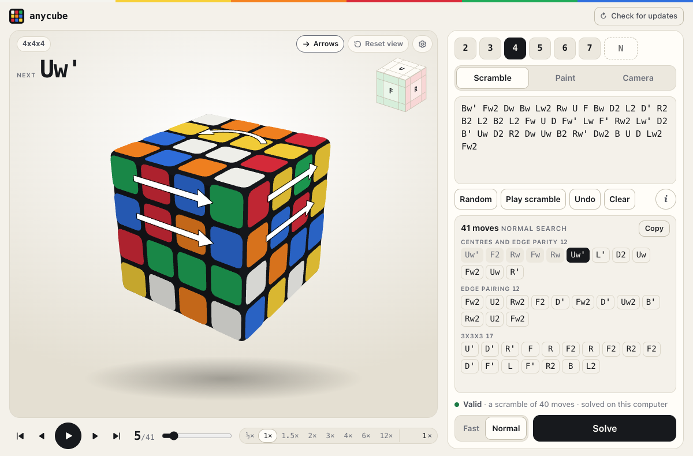

<p align="center">
  
</p>

<h1 align="center">anycube</h1>

<p align="center">
  <b>The shortest solutions of any open-source Rubik's cube solver.</b><br>
  An NxNxN solver written in Rust:<br>
  2x2x2, 3x3x3, 4x4x4, 5x5x5, 6x6x6, 7x7x7 and every larger size.
</p>

<p align="center">
  
  
  
  
</p>

<p align="center">
  <a href="https://anycube.agenticweb.ro"><b>Try it in the browser</b></a> ·
  <a href="#results">Results</a> ·
  <a href="#install-local">Install local</a> ·
  <a href="#usage">Usage</a> ·
  <a href="#how-it-works">How it works</a> ·
  <a href="bench/README.md">Benchmarks</a> ·
  <a href="#thanks">Thanks</a>
</p>

---

anycube solves a Rubik's cube of **any size**, in **seconds**, in **few
moves**.

- **Shorter than the other solvers** on every size from 4x4x4 to 10x10x10, on
  the same scrambles: see the [benchmarks](bench/README.md).
- **Moves are counted in [OBTM](https://www.worldcubeassociation.org/regulations/#12a)**, the outer block turn metric of the
  WCA regulations (a face turned together with any number of layers under it
  is one move). [How the metrics differ](https://www.speedsolving.com/wiki/index.php/Metric).
- **Measured up to 21x21x21**, the largest cube that is mass-produced.
- **2x2x2 and 3x3x3**: optimal solutions (always for 2x2x2, with `--mode full`
  for 3x3x3), or a two-phase solution in a fraction of a second.
- **4x4x4 to 7x7x7**: a solver written for each size, tuned for length.
- **8x8x8 and up**: one general solver that does not know the size. It treats
  groups of layers as smaller cubes and reuses the solvers above.
- Every solution is applied to a full model of the cube and checked before it
  is printed.

The project is young and under active work: each release gets its rows in
the tables below, so the progress can be followed.

## Results

Mean moves (OBTM) and mean seconds per cube.

<!-- releases:begin -->
Release **v0.1.1** (commit `03710a2`, 2026-11-12), default mode:

| Cube | Moves | Seconds | Slowest cube | Memory | Cubes |
|---|---:|---:|---:|---:|---:|
| 2x2x2 | 8.79 | 0.00 | 0.00 | 6 MB | 100 |
| 3x3x3 | 18.13 | 0.20 | 0.35 | 197 MB | 100 |
| 4x4x4 | 40.44 | 2.6 | 3.9 | 2.6 GB | 100 |
| 5x5x5 | 67.30 | 0.65 | 2.5 | 2.5 GB | 200 |
| 6x6x6 | 107.90 | 7.5 | 11.0 | 3.2 GB | 20 |
| 7x7x7 | 152.25 | 3.6 | 6.3 | 3.4 GB | 20 |
| 8x8x8 | 233.75 | 12.6 | 23.1 | 4.8 GB | 20 |
| 9x9x9 | 313.90 | 3.6 | 11.4 | 3.7 GB | 20 |
| 10x10x10 | 399.55 | 12.8 | 26.6 | 5.1 GB | 20 |
| 11x11x11 | 509.60 | 5.9 | 10.6 | 3.4 GB | 5 |
| 12x12x12 | 611.20 | 20.3 | 29.8 | 4.9 GB | 5 |
| 13x13x13 | 757.60 | 13.7 | 20.5 | 3.6 GB | 5 |
| 14x14x14 | 871.20 | 18.9 | 23.9 | 4.2 GB | 5 |
| 15x15x15 | 1031.80 | 16.8 | 22.4 | 3.5 GB | 5 |
| 16x16x16 | 1194.80 | 27.2 | 40.3 | 4.7 GB | 5 |
| 17x17x17 | 1391.80 | 33.8 | 74.0 | 3.8 GB | 5 |
| 18x18x18 | 1534.60 | 38.3 | 46.0 | 4.4 GB | 5 |
| 19x19x19 | 1763.00 | 46.2 | 69.2 | 4.2 GB | 5 |
| 20x20x20 | 1922.40 | 56.5 | 65.1 | 4.3 GB | 5 |
| 21x21x21 | 2248.20 | 68.2 | 112 | 4.2 GB | 5 |

Every release, the newest first: a row of mean moves and a row of mean seconds per cube.

| Release | | 2 | 3 | 4 | 5 | 6 | 7 | 8 | 9 | 10 | 11 | 12 | 13 | 14 | 15 | 16 | 17 | 18 | 19 | 20 | 21 |
|---|---|---:|---:|---:|---:|---:|---:|---:|---:|---:|---:|---:|---:|---:|---:|---:|---:|---:|---:|---:|---:|
| **v0.1.1** | moves | 8.8 | 18.1 | 40.4 | 67.3 | 107.9 | 152.3 | 233.8 | 313.9 | 399.6 | 509.6 | 611.2 | 757.6 | 871.2 | 1031.8 | 1194.8 | 1391.8 | 1534.6 | 1763.0 | 1922.4 | 2248.2 |
| | seconds | 0.00 | 0.20 | 2.6 | 0.65 | 7.5 | 3.6 | 12.6 | 3.6 | 12.8 | 5.9 | 20.3 | 13.7 | 18.9 | 16.8 | 27.2 | 33.8 | 38.3 | 46.2 | 56.5 | 68.2 |
<!-- releases:end -->

Measured on an Apple M1 Pro (10 cores, 16 GB) on the fixed scrambles in
`bench/`, with the lookup tables already made. Memory is the most the whole
run held at once, tables included. Other solvers
on the same scrambles: [`bench/README.md`](bench/README.md).

<a name="install"></a>

## Install local

One command, on macOS and Linux:

```bash
curl -fsSL https://raw.githubusercontent.com/Horia73/anycube/main/install.sh | sh
```

It fetches anycube, builds it (or takes the ready-made program of a release
when there is one for your system), puts it in `~/.local/bin` and offers to
add it to your applications, with its icon. Nothing is written outside your
own directories and nothing needs `sudo`. Building needs Rust: if it is not
installed, the installer stops and names the one command that installs it.
`--uninstall` after the same line (`... | sh -s -- --uninstall`) removes it
all.

On Windows, download the x64 ZIP from [GitHub Releases](https://github.com/Horia73/anycube/releases/latest),
extract it, and run `.\anycube.exe app` in PowerShell from the extracted
folder. To build from source, run `cargo build --release` in a clone.

The local app checks GitHub when it opens and shows **Update available**
when there is a newer release. Use **Check for updates** to check again.
To update, rerun the installer or download the newer Windows ZIP.
The installer downloads a prebuilt program when one is available for your
system and compiles from source otherwise. Compatible lookup tables are reused.

### Install the web app (PWA)

Open [anycube.agenticweb.ro](https://anycube.agenticweb.ro) in one of these
browsers. You can install it straight from the browser without Rust.

- On **iPhone or iPad** in Safari, tap **Share → Add to Home Screen** (look
  under **More** if needed). Enable **Open as Web App** if shown, then tap
  **Add**.
- On **Mac** in Safari (macOS Sonoma 14 or later), choose **File → Add to
  Dock**, then click **Add**.
- On **Windows** in Edge, choose **⋯ → More tools → Apps →
  Install this site as an app**. In Chrome, choose **⋮ → Cast, save, and share →
  Install page as app**.

The web app needs internet access to open. It solves 2×2×2 and 3×3×3 on your
device and uses the server for 4×4×4 through 7×7×7. The local solver above
runs offline.

## Usage

```bash
anycube app
```

<p align="center">
  
</p>

That opens the interface: a cube of any size up to 50x50x50 to scramble,
paint, show to a camera or turn by hand, then solve and follow move by move.
[`app/README.md`](app/README.md) shows the other modes.

The first solve of a size builds its lookup tables, once: a moment for
2x2x2, five seconds for 3x3x3, about three minutes and 4.6 GB for 4x4x4,
about 8.1 GB for every size together.

On the command line, a cube is given as it looks: its stickers face by face
in the order U R F D L B, each face row by row, each sticker named by the
face its colour belongs to. That is the order Kociemba's and dwalton76's
solvers read, and the size is read from the number of stickers.

```bash
# 2x2x2
anycube solve --state BFRRDRRDUFLDUBDLUBFFULBL

# 3x3x3
anycube solve --state LFUBUFUUFUURLRRULFLRRBFURLLBBFRDDFFLDDBFLUDBDBDBDBLDRR

# 4x4x4
anycube solve --state FUDLLDRRLLBULBDULBUFFDBDRLURRDULFRFBULDRUFDDRLBBBDRUBBRBFRRFFDDBRFFDLUULFFBLRULDUFBDRFFBULURDBLU

# 5x5x5
anycube solve --state RFBBRLFBRLFLUFBFBDBRRDDLBDBRFFUBLRRFBRULDFLFFUDUDFFRBBRFDRLBFDFRUFDBUBBUBULURLLFDLDRLLLDURUBDURDFFFLUBRLULFUUUDRLFLLUFRDLRDBLDUUUBBDULDUFBRRRLBDUDRDDB

# 6x6x6
anycube solve --state FRDFLFRLDRRRDBDUDRURUFLLBBULUFDFLUULURDUBRDBUUULUDDFLLLUDLRRLLFLRLDULFFBRUURRFRFFLUFDUBRBFBFURUFRFDBDBBBDRDFRURBLLFLBBDFLLDUFFFDBLRDBBDUFRDBUDBLRBBBLBDRBRBDRFLBRLURBRBULUBLRDLDRBDUUURFUDFDFLDLBDRFUDBDFLFFFFFRLUUUBLDB

# 7x7x7
anycube solve --state LUFDFDUBLRLFFRBLUUDDFBUFUDUFBLFLRFRLRLDFUDFRDUFUFDBULUFRFLBUFRDFDFRRURDDLRLFBFDFUUULFUUDUFBDLBLLURRFBBLBLLRBBLDLUDFDDFLURRFBLFBRUUBRDBBBLLLLLBLLUDBBDBDBFRULURUFDRFDUBFDRFBDFFUULLRBBBBBDFFRLFRUFDFUDRRRRDDUBUURFBLBLFRBLLRLLFLFLDLBULULDDBBUUURFUDFUBRRRRFBRBLBRDRDRLDDRUDDBBRBBDRBDRUDLDBRDUUFDFRRUL
```

Or as the moves that scrambled it, with the size of the cube:

```bash
# 3x3x3, 25 random moves
anycube solve --size 3 "U2 R' F2 L2 U2 R F L2 B' U' L' B2 R2 D2 R2 B D R D' F2 L U2 F' L2 D'"

# the same cube in the fewest moves there are, 18: a few seconds for most cubes, half a minute for this one
anycube solve --size 3 "U2 R' F2 L2 U2 R F L2 B' U' L' B2 R2 D2 R2 B D R D' F2 L U2 F' L2 D'" --mode full

# 5x5x5, 60 random moves, the quick way
anycube solve --size 5 "Bw2 D2 L' F Dw R B U L2 F2 Dw L Dw2 Fw Lw' B' R' Dw Bw' D2 F Lw2 Dw R' B' Rw2 U2 Bw Uw Bw' R2 Dw Fw Dw L' Fw' Lw' Uw2 Bw Dw2 B' Dw2 Bw' L2 Dw' Bw' Lw2 Bw Lw2 U' L2 B2 Lw2 U2 R2 Uw Rw Fw' L2 Uw" --mode fast

# 7x7x7, 100 random moves
anycube solve --size 7 "Rw2 3Uw 3Rw Uw' B2 3Uw2 3Fw2 R Fw' 3Uw' F2 D2 3Fw 3Dw2 Lw2 3Uw 3Bw' Lw2 3Uw' Rw' 3Uw2 3Lw' 3Bw' Uw' F2 Lw2 B' 3Rw Uw Fw' R' B' Lw2 U F' Dw 3Lw2 Uw2 Bw' Rw2 U R' F Uw2 B2 3Lw' Uw' Lw 3Uw' Bw2 U2 3Rw2 3Dw 3Bw' D2 3Bw Uw2 Bw2 Uw' 3Rw2 Bw U' Rw2 Fw2 3Rw Fw L2 3Fw U 3Bw L2 F Uw Rw2 Dw2 R2 3Bw Uw F 3Dw2 Fw2 3Rw Uw 3Bw Dw2 3Fw' 3Lw 3Bw Rw Uw B Rw Uw' F2 Lw' Dw B' 3Lw 3Bw U"

# the first 21x21x21 of the benchmark, 1,050 random moves (in a clone of the repository)
anycube solve --size 21 "$(sed -n 1p bench/scrambles212121-5.txt)"

# the stickers of a scrambled cube, to pass to --state
anycube facelets --size 3 "U2 R' F2 L2 U2 R F L2 B' U' L' B2 R2 D2 R2 B D R D' F2 L U2 F' L2 D'"
```

It prints the solution and, on a second line, what it took. The 4x4x4 state
above:

```text
Fw' L D' L U Uw' B2 Rw U' Uw2 R Fw' R2 B2 D2 F' D' Uw2 Fw2 L2 D F D2 Uw2 Rw2 L2 U2 L' F2 L' D F' R' F2 R' D2 R' U2 L R2 F
41 moves (phases [12, 0, 13, 16]), tables 24 ms, search 3646 ms
```

Moves are written as on any cube: `U R F D L B`, `'` for a turn the other
way, `2` for a half turn; `Rw` turns two layers and `3Rw` three.

## How it works

Every solver here turns the cube into a smaller problem in a few phases and
searches each phase with lookup tables. Each phase starts from many results
of the phase before, and the shortest total wins. A large cube is solved as
a sequence of small ones: groups of its layers behave like a 5x5x5, 6x6x6 or
7x7x7, so the same code runs every size.

## More

- [How each solver works](docs/how-it-works.md), phase by phase
- [The interface](app/README.md): `anycube app`, its page and its local server
- [Commands](docs/commands.md) and [search flags](docs/search-flags.md)
- [Lookup tables](docs/tables.md), file by file
- [Benchmarks](bench/README.md), and [`bench/RESULTS.md`](bench/RESULTS.md):
  the dated log of what was measured, what was tried and what was dropped
- [`FINDINGS.md`](FINDINGS.md): what was learned so far, size by size

## Thanks

All code here is written for this project, but the ideas it stands on are
other people's. Thank you to:

- **[Herbert Kociemba](https://kociemba.org)**, for the
  [two-phase algorithm](https://kociemba.org/cube.htm). It solves the 3x3x3
  here and finishes every larger cube.
- **[Chen Shuang](https://github.com/cs0x7f)**, for
  [TPR](https://github.com/cs0x7f/TPR-4x4x4-Solver) (itself based on Tsai's
  8-step method) and [cube555](https://github.com/cs0x7f/cube555). The 4x4x4
  and 5x5x5 solvers here follow the way his are built.
- **[dwalton76](https://github.com/dwalton76)**, for the
  [NxNxN solver](https://github.com/dwalton76/rubiks-cube-NxNxN-solver) he
  built so that his LEGO Mindstorms robots could take on bigger cubes. It is
  the inspiration for this project, and the general solver here began from
  how his works.

## Licence

MIT, see [LICENSE](LICENSE).
