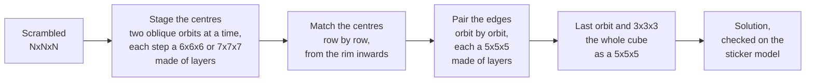

# cubenxnxn

A Rubik's cube solver in Rust for cubes of **any size**, built to find
**short solutions in seconds**.

```bash
./target/release/cubenxnxn solve "$(sed -n 3p bench/scrambles-1000.txt)"
```

```text
Fw R2 U' F Fw' Uw B U2 Rw2 F2 R Fw R F' R' D2 F' Fw2 Rw2 Fw2 R2 B' Uw2 B' F L2 B' R2 D2 L' U' L F2 U B U' B2 F D' B2 U2
41 moves (phases [12, 0, 11, 18]), tables 25 ms, search 2572 ms
```

That is a 4x4x4 scrambled with 100 random moves, solved in 41.

- **2x2x2 and 3x3x3**: optimal solutions (always for 2x2x2, with `--mode full`
  for 3x3x3), or a two-phase solution in about 10 ms.
- **4x4x4 to 7x7x7**: a solver written for each size, tuned for length.
- **8x8x8 and up**: one general solver that does not know the size. It treats
  groups of layers as smaller cubes and reuses the solvers above.
- Every solution is applied to a full model of the cube and checked before it
  is printed.

The project is young and under active work. The numbers below still change;
`bench/RESULTS.md` is the dated log of what was measured, what was tried and
what was dropped.

## Results at a glance

Mean solution length with the default settings, against the strongest solver
we could run for each size, **on the same scrambles**. Moves are counted in
OBTM (any face turn or wide turn is one move). Apple M1 Pro, 8 cores.

| Size | Compared with | Theirs | cubenxnxn | Difference | Cubes | Time, theirs | Time, ours |
|---|---|---|---|---|---|---|---|
| 4x4x4 | [TPR](https://github.com/cs0x7f/TPR-4x4x4-Solver) | 44.57 | **40.60** | **-8.9%** | 1,000 | 0.15 s | 2.5 s |
| 5x5x5 | [cube555](https://github.com/cs0x7f/cube555) | 70.58 | **68.82** | **-2.5%** | 200 | 1.1 s | 1.4 s |
| 6x6x6 | [dwalton76](https://github.com/dwalton76/rubiks-cube-NxNxN-solver) | 136.10 | **109.30** | **-19.7%** | 10 | 43 s | 9.7 s |
| 7x7x7 | dwalton76 | 194.40 | **154.80** | **-20.4%** | 10 | 9.4 s | 6 s |
| 8x8x8 | dwalton76 | 308.40 | **261.60** | **-15.2%** | 5 | 15.8 s | 14.3 s |
| 9x9x9 | dwalton76 | 368.00 | **356.40** | **-3.2%** | 5 | 11.0 s | 32.6 s |
| 10x10x10 | dwalton76 | **523.40** | 531.60 | +1.6% | 5 | 24.8 s | 10.2 s |

What the table does not hide:

- TPR is seventeen times faster on the 4x4x4. `--mode fast` narrows that to
  0.36 s and still averages 41.54 moves.
- On the 10x10x10 dwalton76's solutions are shorter, and on the 9x9x9 ours
  take three times as long.
- The sets for the large cubes are small, because the other solver takes a
  while per cube. Our own runs cover 20 to 50 cubes per size and are in the
  detailed tables below.
- Nobody else has reproduced these numbers yet. The scrambles, every result
  file and the commands are in `bench/`; reports of different results are
  welcome.

## Quick start

```bash
cargo build --release
```

```bash
./target/release/cubenxnxn solve "Rw U2 F' Uw L2 D Bw' R"
```

The size is 4x4x4 unless `--size` says otherwise:

```bash
./target/release/cubenxnxn solve --size 3 "R U R' F2 D L B' U2" --mode full
./target/release/cubenxnxn solve --size 5 "Rw U2 F' Uw L2 D Bw' R" --mode fast
./target/release/cubenxnxn solve --size 7 "3Rw U2 F' Uw L2 D 3Bw' R"
./target/release/cubenxnxn solve --size 9 "4Rw U2 F' 3Uw L2 D Bw' R"
```

A cube can also be given as facelets, 6·N·N letters in URFDLB order:

```bash
./target/release/cubenxnxn solve --state <facelets>
```

**The first run builds lookup tables.** They are generated into `tables/`
(set `CUBENXNXN_TABLES` to put them elsewhere), once: about four minutes and
4.9 GB for the 4x4x4, about 8.4 GB for every size and option. The 2x2x2 and
3x3x3 need only a few megabytes. See [Tables](#tables).

`--mode fast`, `normal` (the default) or `full` trades time for length on
every size that has modes.

## How it works

Every solver here is a reduction solver: it turns the cube into a smaller
problem in a few phases, and each phase is searched with exact lookup tables
where they fit in memory. Three things make the solutions shorter than the
solvers these phases come from:

- **Phases are joined** where the tables allow it, so that one search does
  what two did.
- **Many candidates are kept, not one.** Each phase starts from every result
  of the phase before, and the shortest total wins, not the shortest phase.
- **Every symmetry is used**: the cube may end in any orientation and the
  phases may run along any axis.

### Any size (`src/nnn.rs`)

Some layers of a large cube, taken together, behave like a small cube: pick
a few of them symmetrically and let every layer in between follow the picked
layer next to it towards the middle. Whatever is solved in such a block of
layers stays solved when the small cube is solved, so a large cube can be
done as a sequence of small ones.



- Centres: staged one axis at a time, ring by ring from the middle
  outwards. The rows of a ring are first made each of one kind (all of
  the axis or none), two mirror orbits of oblique centres at a time, each
  step a 6x6x6 or a 7x7x7 made of layers (with the staging of those
  solvers); then the whole ring goes onto its faces in one step, as the x
  and t centres of a 5x5x5. Then, row by row from the rim inwards, every
  centre is made to agree in colour with the one under it
  (`src/rings.rs`); the edge steps bring them home. A short row is matched
  in one search; a long one from its middle outwards, the columns done so
  far kept alike so that each step is a search of the same small size
  whatever the length of the row. Should no matching be found, the centres
  are brought home one step at a time instead (`src/axes.rs`).
- Edges: orbit by orbit from the middle outwards, each a 5x5x5 whose middle
  edges are the stretch already joined (a 4x4x4 for the innermost wings of
  an even cube). The last one is the whole cube as a 5x5x5, solved to the end.

The same code runs every size from 6 up; nothing in it knows the size.

### 4x4x4

The phase structure started from Chen Shuang's
[TPR solver](https://github.com/cs0x7f/TPR-4x4x4-Solver) (itself based on
Tsai's 8-step method) and now has three stages:

1. **Joint phase** (all moves): stage every centre on a face of its own axis,
   bring the R/L centres into a pattern the next phase can finish, make the
   wing permutation even and the dedges pairable. This replaces TPR's phases
   1 and 2. An exact table over all 9.47 billion centre states makes the centre
   part of the search perfect. The last move is tested against the wings
   first, which rejects almost all of them without looking at the centres.
2. **Phase 3** (`U D F B R2 L2 Uw2 Rw2 Fw2`): pair the 12 dedges and solve the
   centres, as in TPR, with an exact table of the pairing permutation.
3. **3x3x3**: Kociemba's two-phase algorithm on the reduced cube, with an exact
   table for its first phase.

What makes the solutions shorter than TPR's:

- Phases 1 and 2 are searched as one phase (about 1.2 moves).
- The solver collects thousands of joint-phase endpoints and many reductions,
  and the 3x3x3 stage picks the reduction with the shortest total (about 2
  moves). The most promising reductions get a much deeper 3x3x3 search.
- The cube has no fixed centres, so it may end in any of 24 orientations and
  the phases may run along any of 3 axes. All 18 distinct combinations are
  tried; one search serves the three axes.

### 5x5x5

- Centres (`src/stage5.rs`): the R/L centres go to the R and L faces with all
  36 moves, then an exact table puts the U/D and F/B centres on their axes.
  Staging all centres in one step (`src/centres5.rs`) is exact and shorter,
  15 moves against 17 on the one cube measured, but took 340 s for it.
- Edges (`src/edges5.rs`), three phases:
  - C: every pair of wings gets one wing in each half of the wing positions,
    matching the flip of its middle edge (face turns and wide half turns);
  - P: four whole edges are built in the middle slice (F and B freely, half
    turns elsewhere), with an exact table for the twelve pieces involved and
    tables of those pieces against the centres;
  - E: the other eight edges and all centres (U and D freely, half turns
    elsewhere), with an exact pairing table.
- The 3x3x3 that is left is solved for many reduced cubes; the shortest total
  wins.
- Each step starts from every result of the step before and keeps the
  continuations that are shortest in total (`src/solver5.rs`). The edge phases
  see the cube from six sides: three choices of axis, two of the slice.

### 6x6x6 and 7x7x7

How they work, what was tried and the per-step lengths are in
`bench/RESULTS.md` (sources: `src/stage6.rs`, `src/solver6.rs`,
`src/stage7.rs`, `src/solver7.rs`, `src/search.rs`).

## Results in detail

All on fixed scramble files in `bench/`, on an Apple M1 Pro.

### 4x4x4 (`bench/scrambles-1000.txt`)

| Solver | Mean length | Mean time | Cubes |
|---|---|---|---|
| TPR (Java) | 44.57 | 146 ms | 1,000 |
| cubenxnxn `--mode fast` | 41.54 | 0.36 s | first 100 |
| cubenxnxn, default | 40.60 | 2.5 s | 1,000 |
| cubenxnxn `--mode full` | 40.00 | 15.9 s | first 30 |

With the defaults no solution is longer than TPR's for the same cube, the
longest is 44 moves and the slowest solve took 5.3 s. Start-up takes about
25 ms once the tables exist.

### 5x5x5 (`bench/scrambles555-200.txt`)

Measured while the machine was busy with other work, so the times are on the
high side.

| Solver | Mean length | Mean time | Longest | Cubes |
|---|---|---|---|---|
| cube555 (Java) with min2phase | 70.58 | 1.1 s | 75 | 200 |
| cubenxnxn `--mode fast` | 70.16 | 0.34 s | 74 | 200 |
| cubenxnxn, default | 68.82 | 1.4 s | 72 | 200 |
| cubenxnxn `--mode full` | 68.20 | 5.3 s | 70 | first 40 |

With the defaults 159 of the 200 solutions are shorter than cube555's, 20 are
equal and 21 are longer; the slowest solve took 3.5 s, and 0.74 s in the fast
mode. The times assume the tables are in memory; the first solve of a process
pays for reading them.

### 6x6x6 and 7x7x7 (`bench/scrambles666-100.txt`, `bench/scrambles777-100.txt`)

Against dwalton76's
[NxNxN solver](https://github.com/dwalton76/rubiks-cube-NxNxN-solver). The
target is 20% fewer moves than his: 108.9 and 155.5.

| Size | Solver | Mean length | Mean time | Cubes | Against dwalton76 |
|---|---|---|---|---|---|
| 6x6x6 | dwalton76 | 136.10 | 43 s | first 10 | |
| 6x6x6 | cubenxnxn `--mode fast` | 112.00 | 4.1 s | first 20 | -17.7% |
| 6x6x6 | cubenxnxn, default | 109.20 | 9.7 s | first 20 | -19.8% |
| 6x6x6 | cubenxnxn `--mode full` | 108.85 | under a minute | first 20 | -20.0% |
| 7x7x7 | dwalton76 | 194.40 | 9.4 s | first 10 | |
| 7x7x7 | cubenxnxn `--mode fast` | 155.60 | 3.3 s | cubes 31 to 50 | -20.0% |
| 7x7x7 | cubenxnxn, default | 154.56 | 6 s | first 50 | -20.5% |

The 7x7x7 meets the target by default; the 6x6x6 meets it in the full mode and
is 0.3 moves short of it by default.

### 8x8x8 and up (`bench/scrambles888-20.txt` and its neighbours)

dwalton76's solver on the first 5 cubes of each set, ours on all 20, every
solution checked on the sticker model. "Bound" is the number of positions
counted in moves, below which no solver can average:

| Size | Bound | dwalton76 | cubenxnxn | cubenxnxn, his 5 cubes | Time, his | Time, ours |
|---|---|---|---|---|---|---|
| 8x8x8 | 117.1 | 308.40 | 264.50 | 261.60 | 15.8 s | 14.3 s |
| 9x9x9 | 149.2 | 368.00 | 349.45 | 356.40 | 11.0 s | 32.6 s |
| 10x10x10 | 179.1 | 523.40 | 529.40 | 531.60 | 24.8 s | 10.2 s |

The solvers for 4x4x4 to 7x7x7 are at 1.4 to 1.7 times the bound; this one
is at 2.3 to 3 times, so most of what can be gained on large cubes is still
ahead. Sizes 11, 12 and 14 solve as well. Run on 6x6x6 and 7x7x7 it gives
122 and 174 moves where their own solvers give 109 and 155.

## Commands

| Command | What it does |
|---|---|
| `solve <moves> [--size N]` | solve a scramble given as moves |
| `solve --state <facelets>` | solve a cube given as facelets in URFDLB order |
| `facelets --size N <moves>` | print the facelets of a scrambled cube |
| `scrambles --size N --count C --length L` | random-move scrambles, one per line |
| `verify --size N <file>` | check solutions; each line is `scramble<TAB>solution` |
| `bench`, `bench5`, `bench6`, `bench7 <file>` | run a scramble file of 4x4x4, 5x5x5, 6x6x6 or 7x7x7 cubes |
| `benchn <file> --size N` | the same for sizes from 8 up |

To reproduce the tables above:

```bash
./target/release/cubenxnxn bench bench/scrambles-1000.txt --tpr bench/tpr-results.tsv
./target/release/cubenxnxn bench5 bench/scrambles555-200.txt
./target/release/cubenxnxn bench6 bench/scrambles666-100.txt --limit 20
./target/release/cubenxnxn bench7 bench/scrambles777-100.txt --limit 10
./target/release/cubenxnxn benchn bench/scrambles101010-20.txt --size 10 --limit 5
```

And to make new scrambles or look at a cube:

```bash
./target/release/cubenxnxn scrambles --size 12 --count 5 --length 480
./target/release/cubenxnxn facelets --size 5 "Uw R' F2"
```

## Tables

Generated on first use into `tables/` (set `CUBENXNXN_TABLES` to move them).
The 4x4x4 set is 4.9 GB; its large files take about four minutes on 8 cores,
once.

| File | Size | Time on 8 cores | Contents |
|---|---|---|---|
| `centres-exact.bin` | 2.37 GB | 105 s | moves to stage all centres, every centre state |
| `slice-exact.bin` | 1.72 GB | 55 s | 3x3x3 distance to "no twist, no flip, slice edges in place" |
| `phase1-exact.bin` | 554 MB | 20 s | 3x3x3 distance to the domino subgroup |
| `pairing.bin` | 240 MB | 20 s | moves to pair the dedges in phase 3 |
| nine small files | 70 MB | under 1 s | everything else, so that start-up reads instead of rebuilding |

The 2x2x2 solver needs only `cube222.bin` (3.7 MB) and the 3x3x3 solver only
`cube333.bin` (10 MB), plus `slice-exact.bin` for `--mode full`.

The 5x5x5 solver has its own tables, 2.1 GB, generated in about two minutes on
8 cores: `phase4-555-*.bin` (850 MB, phase P), `phase5-555*.bin` (600 MB,
phase E), `phase2-555.bin` (331 MB, centres), `phase3-555-sym.bin` (175 MB,
phase C, one entry per class under its 16 symmetries) and four small ones. It
also uses `phase1-exact.bin` for the 3x3x3 step, `stage555-near8.bin`
(320 MB, 30 s: the first centre phase near its goal) and `phase2-333.bin`
(57 MB, 3 s: corners and U/D edges of the 3x3x3 together, used by every size). `--joint` needs two more,
`centres555-x.bin` and `centres555-t.bin` (300 MB each, 100 s to generate).

The 6x6x6 and 7x7x7 solvers add about 0.7 GB (`axes-*.bin`, `stage666-*.bin`,
`stage777-*.bin`). With everything generated the directory holds about 8.4 GB.

## Search flags

<details>
<summary>5x5x5</summary>

`--mode fast|normal|full` sets all of them; each can be overridden.

| Flag | fast | normal | full | Meaning |
|---|---|---|---|---|
| `--time` | 800 | 4000 | 0 | milliseconds the solve aims at; 0 is no limit |
| `--staged` | 400 | 1200 | 4000 | centre stagings kept |
| `--extra` | 2 | 3 | 3 | lengths of the first centre phase searched past its shortest |
| `--a-budget` | 200000 | 1000000 | 10000000 | positions each of those lengths may take from the second on; a length that does not fit is searched in part; 0 is no limit |
| `--labellings` | 8 | 16 | 16 | ways of splitting the wings tried per staging |
| `--c-keep` | 2000 | 6000 | 20000 | results phase C aims for |
| `--p-keep` | 300 | 700 | 2000 | results phase P aims for |
| `--e-keep` | 50 | 100 | 400 | reduced cubes aimed for |
| `--pool`, `--probes` | 30, 1500 | 100, 5000 | 400, 20000 | reduced cubes given the full 3x3x3 effort, and that effort |
| `--joint N` | off | off | off | also stage the centres in one step, exactly, N lengths past the shortest; minutes per cube |

</details>

<details>
<summary>4x4x4</summary>

| Flag | Meaning | Default |
|---|---|---|
| `--mode` | `fast`, `normal` or `full`; sets the flags below | normal |
| `--time` | soft time limit per cube, in ms | 4000 |
| `--n2` | joint-phase endpoints collected | 10000 |
| `--joint-nodes` | node budget of the joint phase, in millions | 1000 |
| `--k3` | endpoints tried in phase 3 | 10000 |
| `--n3` | reductions compared by total length | 2000 |
| `--extra3` | moves past the shortest reduction to keep collecting | 1 |
| `--probes` | 3x3x3 two-phase effort per reduction | 10000 |
| `--refine` | effort multiplier for the best sixteenth of the reductions | 16 |
| `--split` | search phases 1 and 2 separately, as TPR does | off |
| `--n1`, `--k1` | with `--split`: phase-1 solutions enumerated and kept | 10000, 500 |
| `--exact` | node budget (millions) of the exact 3x3x3 search | 0 (off) |
| `--exact-cap` | longest 3x3x3 solution the exact search looks for | 15 |
| `--far-g` | also keep longer reductions this close to a domino subgroup | 0 (off) |

`--mode full` collects fifteen times as many endpoints and adds the exact
3x3x3 search (`src/opt3.rs`), which scans the reductions for 3x3x3 solutions
of up to 16 moves that the two-phase search missed.

</details>

## Verification

Every solution is applied to the full cube model and checked before it is
returned. Beyond that:

- The 4x4x4 model gives the same facelets as TPR for every benchmark
  scramble, and TPR's solutions solve the cube in this model.
- The any-size sticker model (`src/cuben.rs`), built from geometry alone,
  agrees with the 4x4x4 model move for move.
- The 2x2x2 table reproduces the known distance distribution (maximum 11).
- The 3x3x3 domino table reproduces Kociemba's published distribution.
- The shared joint search finds the same endpoints as an unshared one.

## Where things are

| Path | Contents |
|---|---|
| `src/` | the solvers; one file per phase or table family |
| `bench/` | scramble sets, result files of every solver measured, and `RESULTS.md` |
| `bench/RESULTS.md` | dated log: what was measured, what was tried, what did not pay |
| `PLAN.md` | working notes (in Romanian) |

## Credits

All code here is written for this project; nothing is copied from other
solvers. The ideas are not all ours:

- 4x4x4: piece numbering, move definitions and the design of phase 3 come
  from TPR by Chen Shuang (MIT licence).
- 5x5x5: the split into phases follows cube555 by Chen Shuang.
- 3x3x3: the two-phase algorithm and the exact search bounded by distances
  to a subgroup are Herbert Kociemba's.
- The comparisons from 6x6x6 up are against dwalton76's NxNxN solver, which
  set the mark to beat on every one of those sizes.

## Licence

MIT, see [LICENSE](LICENSE).
