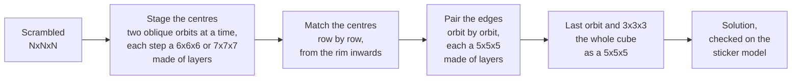

# cubenxnxn

A Rubik's cube solver in Rust for cubes of **any size**, built to find
**short solutions in seconds**. It is measured on every size from 2x2x2 to
21x21x21, the largest cube that is mass-produced.

- **2x2x2 and 3x3x3**: optimal solutions (always for 2x2x2, with `--mode full`
  for 3x3x3), or a two-phase solution in a fraction of a second.
- **4x4x4 to 7x7x7**: a solver written for each size, tuned for length.
- **8x8x8 and up**: one general solver that does not know the size. It treats
  groups of layers as smaller cubes and reuses the solvers above.
- Every solution is applied to a full model of the cube and checked before it
  is printed.

The project is young and under active work: each release gets a row in the
table below, so the progress can be followed.

## Results

Mean number of moves and seconds per cube, by release. Moves are counted in
OBTM (any turn of a face, with any number of layers, is one move).

<!-- releases:begin -->
Release **v0.1.0** (commit `b2f038a`, 2026-11-11), default mode:

| Cube | Moves | Seconds | Longest | Memory | Cubes |
|---|---:|---:|---:|---:|---:|
| 2x2x2 | 8.79 | 0.00 | 0.00 | 6 MB | 100 |
| 3x3x3 | 19.03 | 0.22 | 0.42 | 77 MB | 100 |
| 4x4x4 | 40.71 | 2.8 | 3.8 | 3.0 GB | 100 |
| 5x5x5 | 67.75 | 0.58 | 2.5 | 2.9 GB | 200 |
| 6x6x6 | 108.85 | 8.4 | 10.8 | 3.7 GB | 20 |
| 7x7x7 | 152.75 | 3.8 | 4.7 | 4.0 GB | 20 |
| 8x8x8 | 235.65 | 12.9 | 23.4 | 4.4 GB | 20 |
| 9x9x9 | 314.65 | 3.7 | 12.7 | 4.1 GB | 20 |
| 10x10x10 | 406.05 | 16.6 | 32.7 | 5.3 GB | 20 |
| 11x11x11 | 510.40 | 7.5 | 13.1 | 3.7 GB | 5 |
| 12x12x12 | 619.80 | 21.7 | 28.0 | 4.4 GB | 5 |
| 13x13x13 | 757.80 | 15.8 | 24.2 | 4.0 GB | 5 |
| 14x14x14 | 888.40 | 30.4 | 36.9 | 4.3 GB | 5 |
| 15x15x15 | 1031.80 | 21.4 | 29.0 | 4.3 GB | 5 |
| 16x16x16 | 1185.60 | 40.3 | 45.6 | 4.1 GB | 5 |
| 17x17x17 | 1392.00 | 37.0 | 75.5 | 4.1 GB | 5 |
| 18x18x18 | 1548.00 | 45.8 | 59.8 | 4.1 GB | 5 |
| 19x19x19 | 1763.80 | 49.5 | 72.7 | 3.9 GB | 5 |
| 20x20x20 | 1938.60 | 56.5 | 87.8 | 4.2 GB | 5 |
| 21x21x21 | 2254.00 | 84.2 | 135 | 3.8 GB | 5 |

Every release, the newest first: mean moves, and under them mean seconds per cube.

| Release | 2 | 3 | 4 | 5 | 6 | 7 | 8 | 9 | 10 | 11 | 12 | 13 | 14 | 15 | 16 | 17 | 18 | 19 | 20 | 21 |
|---|---:|---:|---:|---:|---:|---:|---:|---:|---:|---:|---:|---:|---:|---:|---:|---:|---:|---:|---:|---:|
| **v0.1.0** | 8.8<br>0.00 s | 19.0<br>0.22 s | 40.7<br>2.8 s | 67.8<br>0.58 s | 108.8<br>8.4 s | 152.8<br>3.8 s | 235.7<br>12.9 s | 314.6<br>3.7 s | 406.1<br>16.6 s | 510.4<br>7.5 s | 619.8<br>21.7 s | 757.8<br>15.8 s | 888.4<br>30.4 s | 1031.8<br>21.4 s | 1185.6<br>40.3 s | 1392.0<br>37.0 s | 1548.0<br>45.8 s | 1763.8<br>49.5 s | 1938.6<br>56.5 s | 2254.0<br>84.2 s |
<!-- releases:end -->

How to read it:

- Measured on an Apple M1 Pro (10 cores, 16 GB) with the default mode of
  every size, on the fixed scrambles in `bench/` (random moves; the "Cubes"
  column says how many).
- Seconds are per cube, with the lookup tables already made; "Longest" is the
  slowest cube.
- Memory is the most the whole run held at once, lookup tables included.
- Two runs of the same release differ a little on the large cubes, a few
  moves on one cube: the searches run on all cores and not every one of
  them is repeatable yet.
- A release is measured with `scripts/release.py measure <name>` and the
  tables are written with `scripts/release.py readme`; the numbers are kept
  in `bench/releases.tsv`.

## Install

Rust is all it needs ([rustup.rs](https://rustup.rs)):

```bash
cargo build --release
```

**The first solve of a size builds its lookup tables**, once, into `tables/`
(set `CUBENXNXN_TABLES` to put them elsewhere). The 2x2x2 and 3x3x3 need a few
megabytes and a moment; the 4x4x4 about four minutes and 4.9 GB; every size
together about 8.5 GB. See [Tables](#tables).

## Usage

A scramble is given as moves. The size is 4x4x4 unless `--size` says
otherwise:

```bash
./target/release/cubenxnxn solve "Rw U2 F' Uw L2 D Bw' R"
```

```bash
./target/release/cubenxnxn solve --size 7 "3Rw U2 F' Uw L2 D 3Bw' R"
```

A cube can also be given as it looks, 6·N·N letters in the order of the faces
U R F D L B:

```bash
./target/release/cubenxnxn solve --state <facelets>
```

`--mode fast`, `normal` (the default) or `full` trades time for length on
the sizes that have modes (3x3x3 to 7x7x7).

Moves are written as on any cube: `U R F D L B` for the faces, `'` for a
turn the other way, `2` for a half turn; `Rw` turns two layers and `3Rw`
three.

## Examples

A 2x2x2, always solved in the fewest moves there are:

```bash
./target/release/cubenxnxn solve --size 2 "R U2 F' R2 U F R' U' F2 R"
```

```text
R2 F' U R F2 R2 F U2 R'
9 moves, optimal, 7 ms
```

A 3x3x3:

```bash
./target/release/cubenxnxn solve --size 3 "R U R' F2 D L B' U2 R2 D' F L2 U B2 R' D2 F' L U2 B"
```

```text
D' R' L2 U' B2 D' B D2 B' L B' U2 R2 U D2 R2 F2 D R2 D'
20 moves, two-phase search, 405 ms
```

A 4x4x4 scrambled with 100 random moves (the third line of the scramble
file):

```bash
./target/release/cubenxnxn solve "$(sed -n 3p bench/scrambles-1000.txt)"
```

```text
Fw R2 U' F Fw' Uw B U2 Rw2 F2 R Fw R F' R' D2 F' Fw2 Rw2 Fw2 R2 B' Uw2 B' F L2 B' R2 D2 L' U' L F2 U B U' B2 F D' B2 U2
41 moves (phases [12, 0, 11, 18]), tables 28 ms, search 3247 ms
```

A 7x7x7 scrambled with 200 random moves:

```bash
./target/release/cubenxnxn solve --size 7 "$(sed -n 1p bench/scrambles777-100.txt)"
```

```text
Dw Rw 3Bw Rw2 D 3Dw2 3Lw2 3Bw 3Dw' 3Fw' L2 Lw' 3Bw2 Lw' 3Rw' 3Bw2 Uw 3Lw' R D Rw' Fw Lw Fw2 L' Bw Rw Uw' D2 3Rw' D' 3Lw ...
154 moves (staging 51, matching 17, inner edges 34, outer edges 34, 3x3x3 18), tables 551 ms, search 7386 ms
```

And a 21x21x21 scrambled with 1,050 random moves:

```bash
./target/release/cubenxnxn solve --size 21 "$(sed -n 1p bench/scrambles212121-5.txt)"
```

```text
U' D 10Fw' R 10Rw' 10Dw' F 10Lw D2 10Fw 10Lw2 B2 9Uw 10Uw2 10Fw2 9Uw' 9Rw' 9Fw' 10Fw2 10Rw2 R' 9Bw' ...
2126 moves (centres 1800, edges 308, 3x3x3 18), tables 1158 ms, search 59571 ms
```

The solution goes to standard output and the summary line to standard
error, so a solution can be piped on its own.

## How it works

Every solver here is a reduction solver: it turns the cube into a smaller
problem in a few phases, and each phase is searched with exact lookup tables
where they fit in memory. Three things keep the solutions short:

- **Phases are joined** where the tables allow it, so that one search does
  what two did.
- **Many candidates are kept, not one.** Each phase starts from every result
  of the phase before, and the shortest total wins, not the shortest phase.
- **Every symmetry is used**: the cube may end in any orientation and the
  phases may run along any axis.

### Any size (`src/nnn.rs`)

Some layers of a large cube, taken together, behave like a small cube: pick
a few of them symmetrically and let every layer in between follow the picked
layer next to it towards the middle. Whatever is solved in such a block of
layers stays solved when the small cube is solved, so a large cube can be
done as a sequence of small ones.



- Centres: staged one axis at a time, ring by ring from the middle
  outwards. The rows of a ring are first made each of one kind (all of
  the axis or none), two mirror orbits of oblique centres at a time, each
  step a 6x6x6 or a 7x7x7 made of layers (with the staging of those
  solvers); then the whole ring goes onto its faces in one step, as the x
  and t centres of a 5x5x5. Then, row by row from the rim inwards, every
  centre is made to agree in colour with the one under it
  (`src/rings.rs`); the edge steps bring them home. A short row is matched
  in one search; a long one from its middle outwards, the columns done so
  far kept alike so that each step is a search of the same small size
  whatever the length of the row. Should no matching be found, the centres
  are brought home one step at a time instead (`src/axes.rs`).
- Edges: orbit by orbit from the middle outwards, each a 5x5x5 whose middle
  edges are the stretch already joined (a 4x4x4 for the innermost wings of
  an even cube). The last one is the whole cube as a 5x5x5, solved to the end.

The same code runs every size from 6 up; nothing in it knows the size.

### 4x4x4

The phase structure started from Chen Shuang's
[TPR solver](https://github.com/cs0x7f/TPR-4x4x4-Solver) (itself based on
Tsai's 8-step method) and now has three stages:

1. **Joint phase** (all moves): stage every centre on a face of its own axis,
   bring the R/L centres into a pattern the next phase can finish, make the
   wing permutation even and the dedges pairable. This replaces TPR's phases
   1 and 2. An exact table over all 9.47 billion centre states makes the centre
   part of the search perfect. The last move is tested against the wings
   first, which rejects almost all of them without looking at the centres.
2. **Phase 3** (`U D F B R2 L2 Uw2 Rw2 Fw2`): pair the 12 dedges and solve the
   centres, as in TPR, with an exact table of the pairing permutation.
3. **3x3x3**: Kociemba's two-phase algorithm on the reduced cube, with an exact
   table for its first phase.

What keeps the solutions short:

- Phases 1 and 2 of TPR are searched as one phase (about 1.2 moves).
- The solver collects thousands of joint-phase endpoints and many reductions,
  and the 3x3x3 stage picks the reduction with the shortest total (about 2
  moves). The most promising reductions get a much deeper 3x3x3 search.
- The cube has no fixed centres, so it may end in any of 24 orientations and
  the phases may run along any of 3 axes. All 18 distinct combinations are
  tried; one search serves the three axes.

### 5x5x5

- Centres (`src/stage5.rs`): the R/L centres go to the R and L faces with all
  36 moves, then an exact table puts the U/D and F/B centres on their axes.
  Staging all centres in one step (`src/centres5.rs`) is exact and shorter,
  15 moves against 17 on the one cube measured, but took 340 s for it.
- Edges (`src/edges5.rs`), three phases:
  - C: every pair of wings gets one wing in each half of the wing positions,
    matching the flip of its middle edge (face turns and wide half turns);
  - P: four whole edges are built in the middle slice (F and B freely, half
    turns elsewhere), with an exact table for the twelve pieces involved and
    tables of those pieces against the centres;
  - E: the other eight edges and all centres (U and D freely, half turns
    elsewhere), with an exact pairing table.
- The 3x3x3 that is left is solved for many reduced cubes; the shortest total
  wins.
- Each step starts from every result of the step before and keeps the
  continuations that are shortest in total (`src/solver5.rs`). The edge phases
  see the cube from six sides: three choices of axis, two of the slice.

### 6x6x6 and 7x7x7

How they work, what was tried and the per-step lengths are in
`bench/RESULTS.md` (sources: `src/stage6.rs`, `src/solver6.rs`,
`src/stage7.rs`, `src/solver7.rs`, `src/search.rs`).

## Commands

| Command | What it does |
|---|---|
| `solve <moves> [--size N]` | solve a scramble given as moves |
| `solve --state <facelets>` | solve a cube given as facelets in URFDLB order |
| `facelets --size N <moves>` | print the facelets of a scrambled cube |
| `scrambles --size N --count C --length L` | random-move scrambles, one per line |
| `verify --size N <file>` | check solutions; each line is `scramble<TAB>solution` |
| `row <file> --size N` | solve a scramble file of any size: mean moves and seconds on one line |
| `bench`, `bench5`, `bench6`, `bench7 <file>` | the same for 4x4x4 to 7x7x7 with the lengths of every step |
| `benchn <file> --size N` | and for sizes from 8 up |

The row of one size in the results table, and the whole table for a release:

```bash
./target/release/cubenxnxn row bench/scrambles101010-20.txt --size 10
```

```bash
scripts/release.py measure v0.2.0
```

```bash
scripts/release.py readme
```

To make new scrambles or look at a cube:

```bash
./target/release/cubenxnxn scrambles --size 12 --count 5 --length 600
```

```bash
./target/release/cubenxnxn facelets --size 5 "Uw R' F2"
```

## Tables

Generated on first use into `tables/` (set `CUBENXNXN_TABLES` to move them).
The 4x4x4 set is 4.9 GB; its large files take about four minutes on 8 cores,
once.

| File | Size | Time on 8 cores | Contents |
|---|---|---|---|
| `centres-exact.bin` | 2.37 GB | 105 s | moves to stage all centres, every centre state |
| `slice-exact.bin` | 1.72 GB | 55 s | 3x3x3 distance to "no twist, no flip, slice edges in place" |
| `phase1-exact.bin` | 554 MB | 20 s | 3x3x3 distance to the domino subgroup |
| `pairing.bin` | 240 MB | 20 s | moves to pair the dedges in phase 3 |
| nine small files | 70 MB | under 1 s | everything else, so that start-up reads instead of rebuilding |

The 2x2x2 solver needs only `cube222.bin` (3.7 MB) and the 3x3x3 solver only
`cube333.bin` (10 MB), plus `slice-exact.bin` for `--mode full`.

The 5x5x5 solver has its own tables, 2.1 GB, generated in about two minutes on
8 cores: `phase4-555-*.bin` (850 MB, phase P), `phase5-555*.bin` (600 MB,
phase E), `phase2-555.bin` (331 MB, centres), `phase3-555-sym.bin` (175 MB,
phase C, one entry per class under its 16 symmetries) and four small ones. It
also uses `phase1-exact.bin` for the 3x3x3 step, `stage555-near8.bin`
(320 MB, 30 s: the first centre phase near its goal) and `phase2-333.bin`
(57 MB, 3 s: corners and U/D edges of the 3x3x3 together, used by every size). `--joint` needs two more,
`centres555-x.bin` and `centres555-t.bin` (300 MB each, 100 s to generate).

The 6x6x6 and 7x7x7 solvers add about 0.7 GB (`axes-*.bin`, `stage666-*.bin`,
`stage777-*.bin`).

Sizes from 8 up need no tables of their own size: they use the ones above,
and twelve small ones for matching rows of centres (`ring-*.bin`, 24 MB
each), which every size shares. With everything generated the directory
holds about 8.5 GB.

## Search flags

<details>
<summary>5x5x5</summary>

`--mode fast|normal|full` sets all of them; each can be overridden.

| Flag | fast | normal | full | Meaning |
|---|---|---|---|---|
| `--time` | 800 | 4000 | 0 | milliseconds the solve aims at; 0 is no limit |
| `--staged` | 400 | 1200 | 4000 | centre stagings kept |
| `--extra` | 2 | 3 | 3 | lengths of the first centre phase searched past its shortest |
| `--a-budget` | 200000 | 1000000 | 10000000 | positions each of those lengths may take from the second on; a length that does not fit is searched in part; 0 is no limit |
| `--labellings` | 8 | 16 | 16 | ways of splitting the wings tried per staging |
| `--c-keep` | 2000 | 6000 | 20000 | results phase C aims for |
| `--p-keep` | 300 | 700 | 2000 | results phase P aims for |
| `--e-keep` | 50 | 100 | 400 | reduced cubes aimed for |
| `--pool`, `--probes` | 30, 1500 | 100, 5000 | 400, 20000 | reduced cubes given the full 3x3x3 effort, and that effort |
| `--joint N` | off | off | off | also stage the centres in one step, exactly, N lengths past the shortest; minutes per cube |

</details>

<details>
<summary>4x4x4</summary>

| Flag | Meaning | Default |
|---|---|---|
| `--mode` | `fast`, `normal` or `full`; sets the flags below | normal |
| `--time` | soft time limit per cube, in ms | 4000 |
| `--n2` | joint-phase endpoints collected | 10000 |
| `--joint-nodes` | node budget of the joint phase, in millions | 1000 |
| `--k3` | endpoints tried in phase 3 | 10000 |
| `--n3` | reductions compared by total length | 2000 |
| `--extra3` | moves past the shortest reduction to keep collecting | 1 |
| `--probes` | 3x3x3 two-phase effort per reduction | 10000 |
| `--refine` | effort multiplier for the best sixteenth of the reductions | 16 |
| `--split` | search phases 1 and 2 separately, as TPR does | off |
| `--n1`, `--k1` | with `--split`: phase-1 solutions enumerated and kept | 10000, 500 |
| `--exact` | node budget (millions) of the exact 3x3x3 search | 0 (off) |
| `--exact-cap` | longest 3x3x3 solution the exact search looks for | 15 |
| `--far-g` | also keep longer reductions this close to a domino subgroup | 0 (off) |

`--mode full` collects fifteen times as many endpoints and adds the exact
3x3x3 search (`src/opt3.rs`), which scans the reductions for 3x3x3 solutions
of up to 16 moves that the two-phase search missed.

</details>

## Verification

Every solution is applied to the full cube model and checked before it is
returned. Beyond that:

- The 4x4x4 model gives the same facelets as TPR for every benchmark
  scramble, and TPR's solutions solve the cube in this model.
- The any-size sticker model (`src/cuben.rs`), built from geometry alone,
  agrees with the 4x4x4 model move for move.
- The 2x2x2 table reproduces the known distance distribution (maximum 11).
- The 3x3x3 domino table reproduces Kociemba's published distribution.
- The shared joint search finds the same endpoints as an unshared one.

## Where things are

| Path | Contents |
|---|---|
| `src/` | the solvers; one file per phase or table family |
| `bench/` | scramble sets, result files of every solver measured, and `RESULTS.md` |
| `bench/releases.tsv` | the numbers behind the results table, one line per release and size |
| `bench/RESULTS.md` | dated log: what was measured, what was tried, what did not pay |
| `scripts/release.py` | measures a release and writes the results table |
| `FINDINGS.md` | what was learned so far, size by size |
| `PLAN.md` | working notes (in Romanian) |

## References and thanks

All code here is written for this project. The ideas it stands on are other
people's, and it would not exist without them:

- **Herbert Kociemba**: the [two-phase algorithm](https://kociemba.org/cube.htm)
  and the exact search bounded by distances to a subgroup, used for the
  3x3x3 and at the end of every larger cube.
- **Chen Shuang**: [TPR](https://github.com/cs0x7f/TPR-4x4x4-Solver) (itself
  based on Tsai's 8-step method), where the 4x4x4's piece numbering, move
  definitions and third phase come from, and
  [cube555](https://github.com/cs0x7f/cube555), whose split into phases the
  5x5x5 follows.
- **dwalton76**: the
  [NxNxN solver](https://github.com/dwalton76/rubiks-cube-NxNxN-solver), which
  showed that one program can solve every size and is where the general
  solver's first version started.

Their solvers were run on the same scrambles while this one was built; those
results are in `bench/` and in `bench/RESULTS.md`, the dated log of what was
measured, what was tried and what was dropped.

## Licence

MIT, see [LICENSE](LICENSE).
