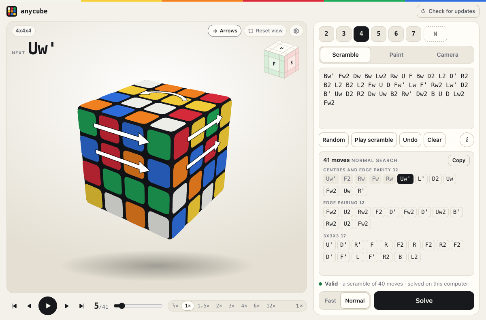
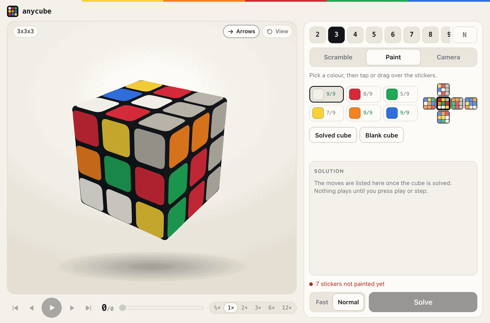
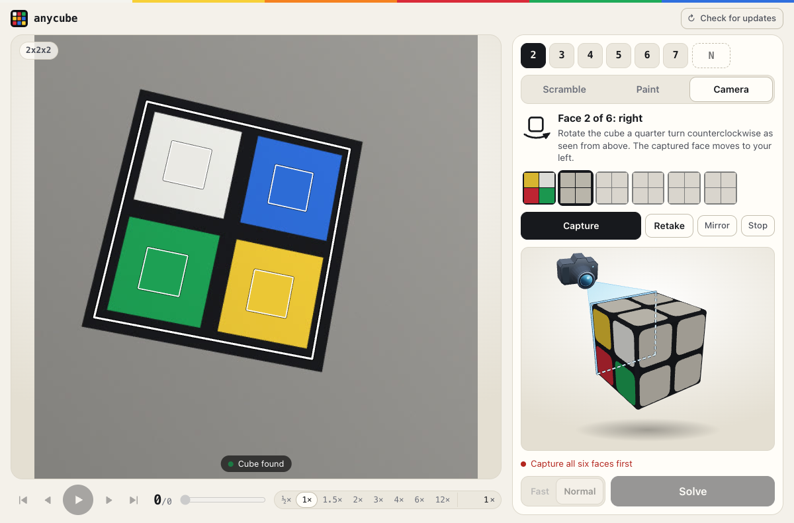

# The interface

`anycube app` opens a window with a cube in it: any size up to 50x50x50,
to scramble, paint, show to a camera, turn by hand, solve and follow move
by move. Everything runs on the machine it is started on.

Use the gear next to the cube to choose white or yellow on top for scrambles
and new painted cubes. After a camera scan, the preview keeps the position
of the last capture by default. The gear also lets you use the default top
colour for scans.

<p align="center">
  
</p>

Paint a cube sticker by sticker; the line above Solve says what is still
missing or wrong, and Solve waits until the cube is one that exists:

<p align="center">
  
</p>

Or hold it up to a camera, a face at a time. Camera images stay in the
browser. The example below uses a simulated camera feed.

<p align="center">
  
</p>

A valid scan starts the search automatically. When the solution is ready,
press Space to play or pause it. Use a preset speed or enter a multiplier
between 0.25× and 24×.

| Path | What it is |
|---|---|
| `index.html`, `app.css`, `js/` | The page: plain HTML, CSS and JavaScript modules, no build step, nothing loaded from anywhere else. Built into the program (`src/app/assets.rs`) |
| `icon/` | The icon: `make-icon.py` draws `icon.svg`; the PNG files are what an application entry is made from |
| `wasm/` | The 2x2x2 and 3x3x3 solvers compiled to WebAssembly, for a page that solves in the browser. `anycube app` does not need it |
| `tests/` | Tests of the page's JavaScript, run under Node |
| `../src/api/` | What the page's server asks: is this a cube, solve it, scramble it |
| `../src/app/` | `server.rs` (the local server), `window.rs` and `window.js` (the window), `install.rs` (the entry among the applications) |

## How it runs

- **The server** listens on 127.0.0.1 only, on a free port, and answers only
  requests addressed to that address. It serves the page and a small JSON
  API (`src/app/server.rs` lists it). One search runs at a time, in a child
  process that keeps each size's tables loaded; Cancel stops that process,
  which is the only way to stop a search.
- **The window** is the system's own: on macOS a Cocoa window with WebKit in
  it, driven by `osascript` (`src/app/window.js`), so there is nothing to
  install and no browser involved; elsewhere a Chromium-family browser
  started as an application window, if one is installed, and the default
  browser failing that. `--browser` asks for the default browser.
- **Lookup tables** are built on first use, as on the command line. What
  the solver reports while it builds them is passed to the page, which
  shows it under "Loading the tables". They go to `ANYCUBE_TABLES` if
  set, else `./tables` if that exists, else the user's application data
  (`~/Library/Application Support/anycube/tables` on macOS,
  `~/.local/share/anycube/tables` on Linux). The command line of an
  installed program follows the same rule; a program run from the
  repository it was built in keeps the solver's own default, `./tables`.
- **The entry among the applications** (`anycube app --install`): on
  macOS `~/Applications/anycube.app`, a bundle with `Info.plist`, icon
  set and a launcher, made on the machine so that it opens without a
  warning; on Linux a `.desktop` entry and the icon in the usual sizes
  under `~/.local/share`. Windows is not done.

## The page

`mount(root, options)` in `js/app.js` builds the application inside an
element. `js/main.js` is the whole of what `anycube app` adds to that. A
page that hosts the application elsewhere (a web site) passes what is its
own as options: nodes for the bar at the top, the largest size to draw,
what to say about a cube larger than its server solves. Nothing about a
host is written in these files.

- `cube-model.js`: the solver's sticker model again, the notation people
  type (lower case, `x y z`, `M E S`), a layer turned by hand as moves.
- `cube-view.js`: the cube in 3D on a 2D canvas, layers mid-turn, arrows
  for the next move, and the cube as something to touch: a drag on a
  sticker turns its layer, a tap paints, a drag beside the cube looks round.
- `player.js`: play, pause, step, speed; the arrows of a move turn with its
  layers and give way to those of the next.
- `solver.js`: where a cube gets solved. With the WebAssembly build beside
  the page (`pkg/anycube.wasm`), the 2x2x2 and 3x3x3 are solved, checked
  and scrambled in the browser; otherwise by the server.
- `camera.js`: the six faces through a camera, one after another, with a
  drawing and a sentence for what the hands do at each step. The face is
  found wherever it is in the picture and outlined there, with a mark over
  every sticker in the colour it is being read as; a grid in a fixed place
  is what is used when no face is found. Capture is pressed by the person,
  and a face shown twice is said at once. The picture never leaves the page.
- `detect.js`: one frame to the face of the cube in it: flat patches shaped
  like stickers, an N by N lattice among their middles, its four corners
  and the colour of each sticker with the perspective undone. About 4 ms a
  frame; no library.
- `colour.js`: the 6*N*N samples sorted into six colours by likeness, all
  together, each colour a direction (so that shade does not move it) and
  each picture with its own white balance taken out. Red and orange are
  what it is built round.
- `scan-fit.js`: the six pictures put together the way they make a cube:
  a face held a quarter turn round or shown out of turn is put right when
  the cube fits together only one way, and two stickers the sorting was
  unsure of are exchanged when that is what makes a cube.
- `paint.js`: the colours to paint with and the cube unfolded.
- `robot.js`: a cube robot driven from the page, mounted only when the
  server's `/api/config` says `robots: true` (the contract is
  `robots-spec/API.md`). See below.

## A robot

When the server drives robots, a Robot button sits by the cube, and the
page watches for a robot: while none is connected it asks `/api/robots`
every 2 seconds and connects the one that is plugged in, without the
dialog. Which that is, the server says port by port when it identifies its
boards (`ports`: a port with a `driver` is that robot; one that answered
as no robot, or is in use, is left alone); a server that only names its
ports has the port connected that one driver claims, or the driver of last
time. The robot connected last is remembered on this device. A robot that
does not connect is tried again after 4, 8, 16 and 32 seconds, then left
until it is plugged in anew. When the server says the robot is gone (a
`disconnected` event, or `connected: null` when the page asks after an
error), the page is as it is without one and watches again. A robot
disconnected by hand stays so until its cable has been out and in, or
Connect is pressed. The dialog chooses driver and port by hand and
switches the connecting by itself off; a robot the server already holds
is taken up in any case (the page was reloaded).

The robot is connected for the size of cube on the page, if it takes that
size; another size chosen while it is connected and at rest connects it
anew for that size.

While a robot is connected, the scramble, paint and camera give way to
the robot's panel: the camera as the robot's photos take it (the middle
square, not mirrored, with the grid of 0.8 of its side), the six photos of
the last scan, the camera to use (remembered on this device), and one line
of what the robot or the page has to say, always whole: the camera and the
photos make way for it. Solve gives way to Scan. Everything else is as it
was. Without a robot, or without a server that drives robots, nothing of
it is on the page.

Scan starts the robot and follows its events (`/api/robot/events`, long
polls). At each `photo` the page grabs the frame of the moment, cuts out
its centred square, turns it as the event says, and answers `photo-taken`
at once. The face is read afterwards, while the robot moves on:
`detect.js`, or a centred grid of 0.8 of the side when no face is found,
then `colour.js` and `scan-fit.js`, as MultiCuber's `anycube_scan.mjs`
does. The six faces fill in on the cube as they are read. A scan that
makes no cube is shown as the camera's would be, and nothing more is asked
of the robot. Otherwise the cube goes to `/api/robot/solve` with
`analysis_ms`, the time from `scan-done` to the facelets. The cube on
screen turns each move as the robot starts it, over its estimated time;
the time left is the plan's, corrected by the ops as they finish; at the
end the times of the run are shown (how the photos were read is in the
title of Analysis and of the robot's line). Scan is Stop while the robot
moves.

How large a photo is read (`ReadPace`): the robot takes about a second
from photo to photo, and that time goes to a larger picture. The sizes
are 240, 320, 360, 400, 480, 560, 640 and 720 pixels a side (from 360 for
a 6x6x6 and up; 720 is the square of the 1280 by 720 the camera is asked
for). Each photo is read at the largest size that takes no more than half
the time to the next photo: what a size costs is measured on every
reading (the machine's rate, a slower reading counting at once; the cost
of a size goes as its side to the power 1.5), and the time to the next
photo is the server's `next_ms` if it gives one, else the
shortest seen between two photos, 800 ms before any was seen. The very
first photo after the page is opened is read at 480, since nothing is
measured yet. The last photo of a scan has only `scan-done` behind it, so
it is read at the largest size that takes 25 ms: that and the assembly
are all of `analysis_ms`.

Measured in headless Chromium (software rendering, a machine busy with
other work) on a 1280 by 720 video of the robot's own pictures of a 4x4x4
(MultiCuber's `CubeScan`) and of drawn pictures of a 3x3x3, median of 18
readings: a face in 13, 21, 42, 60 and 73 ms at 240, 320, 480, 640 and 720
pixels (9 and 65 ms at best at 240 and 720), every face found at every
size. Grabbing the frame, which is what the robot waits for, takes the
same at every size (the video frame is what costs, not the square cut
from it): 7 to 15 ms there, without a graphics card. Putting the six faces together: 2 to 5 ms for a 3x3x3, 6 to 14 ms
for a 4x4x4. With the robot a second from photo to photo, every face but
the last is read at 720 in about 70 ms, the last at 320 in about 20 ms.
The first reading in a page is several times slower, so the page reads
once when a robot is connected.

`node app/tests/robot-mock-server.mjs` serves the page with a mock robot
behind a mock server (`tests/robot-mock.mjs`, the same one the tests run
against); `--unplugged` starts with the cable out, `/mock/plug` and
`/mock/unplug` are the cable.

## Limits

| | Limit | Why |
|---|---|---|
| Size in the interface | 50x50x50 | What the 3D view draws at speed: a frame with layers mid-turn takes 5 ms at 20x20x20, 22 ms at 50, 145 ms at 101 (M1 Pro, 1100 pixels). The command line has no such limit |
| Painting, camera | 7x7x7 | 294 stickers; the colour sorting is tested to 7 |
| A scramble | 5,000 moves | |

## Tests

```bash
cargo test --lib api:: app::
```

```bash
cargo build --release -p anycube-wasm --target wasm32-unknown-unknown
```

```bash
node --test app/tests/*.test.mjs
```

`robot.test.mjs` reads MultiCuber's `CubeScan` pictures when that
repository is beside this one (or at `$MULTICUBER_CUBESCAN`) and skips
those cases otherwise.

The Node tests that compare the page's model with the solver's need the
WebAssembly build and skip without it; `cargo test --test wasm_native` runs
the browser's solver against the native one on the same cubes.

## Not done

- **Following a cube as it is turned in front of the camera**, and reading
  moves from the picture. `detect.js` finds a face in a frame and
  `camera.js` draws what it finds; what is missing is comparing each frame
  with what every possible next move would show. A move found that way is
  a call to the same `turned(face, layer, quarters)` that a dragged layer
  makes.
- **Holding the camera's exposure and white balance** fixed between the six
  pictures, where a browser allows it: not tried on a camera. `colour.js`
  takes each picture's own cast out instead.
- **Real camera coverage is limited**: three recorded 5x5x5 scans are
  replayed as tests, including a failed scan where the glare model confused
  shaded red with clipped orange. When that model cannot reconstruct a
  cube, the original Lab colour groups are tried again, requiring exact
  counts and a valid cube in the captured face order. Other sizes, makers,
  lighting, logos and fingers over stickers still need more real cases.
- **Glare** that clips a sticker to white hides its colour. On a 3x3x3 one
  such sticker is exchanged with the one it pushed out of the white group
  when that alone makes a cube. Glare on two or more middle stickers, or
  on centre stickers of a 4x4x4 or larger (which no piece check covers), is
  refused unless the washed-out stickers all read as one colour and nothing
  else had to move for them; the page then asks for the light to be moved.
  Measured on rendered pictures only (MultiCuber's `tools/vision_eval.py`).
- **Windows**: no window of its own and no application entry there yet.
- **The camera inside the macOS window** has not been tried on a real
  camera: the page finds the camera interface there, and the bundle
  declares why it wants it, but the permission prompt has not been seen.
