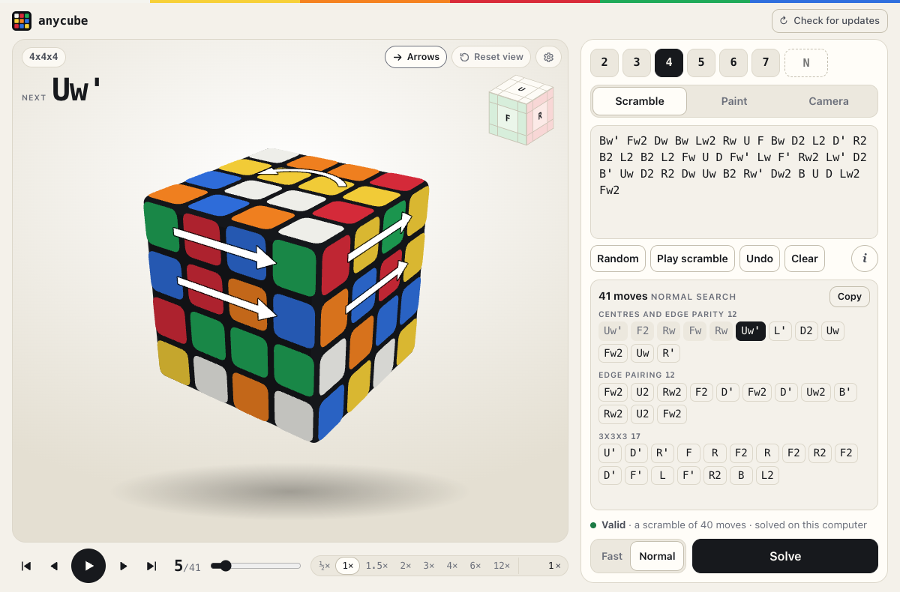
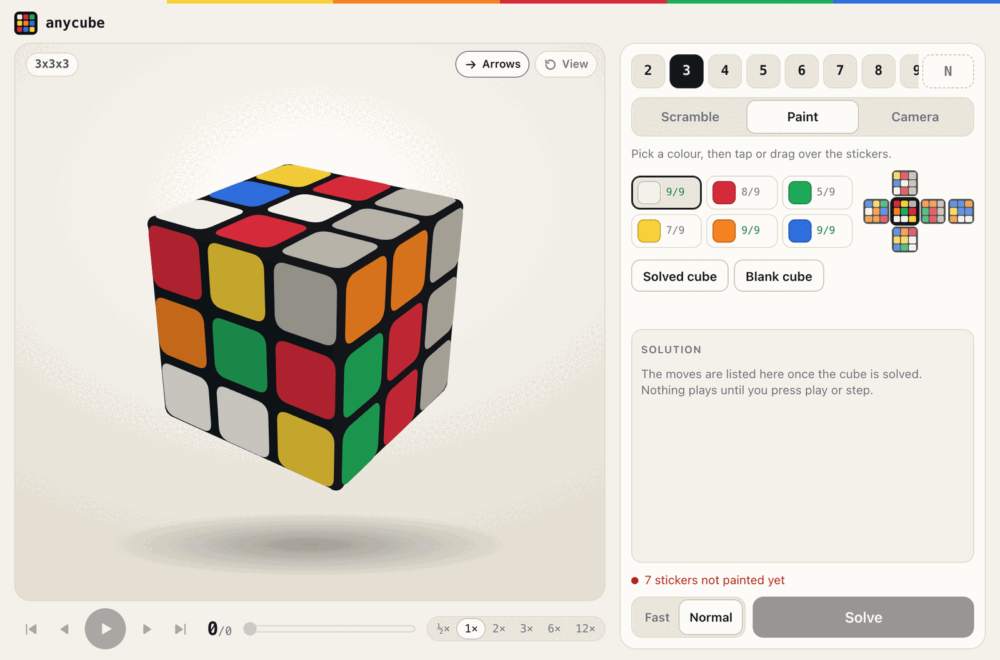
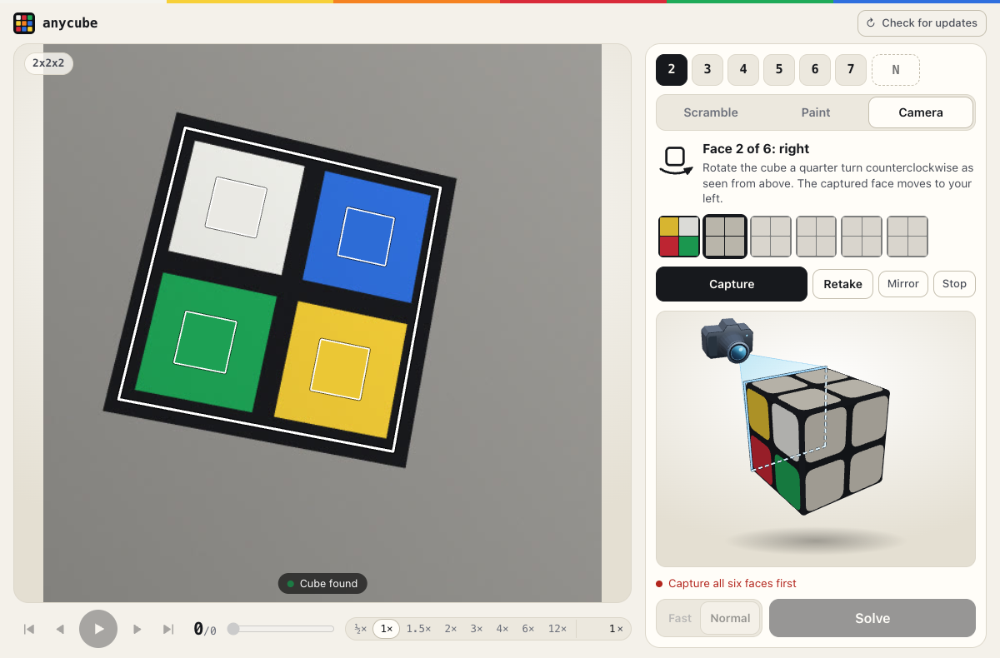

# The interface

`anycube app` opens a window with a cube in it: any size up to 50x50x50,
to scramble, paint, show to a camera, turn by hand, solve and follow move
by move. Everything runs on the machine it is started on.

Use the gear next to the cube to choose white or yellow on top for scrambles
and new painted cubes. Green stays in front. Cubes read by the camera keep
their own colours.

<p align="center">
  
</p>

Paint a cube sticker by sticker; the line above Solve says what is still
missing or wrong, and Solve waits until the cube is one that exists:

<p align="center">
  
</p>

Or hold it up to a camera, a face at a time (the picture never leaves the
computer; this one is a drawing of a face, not a camera's):

<p align="center">
  
</p>

| Path | What it is |
|---|---|
| `index.html`, `app.css`, `js/` | The page: plain HTML, CSS and JavaScript modules, no build step, nothing loaded from anywhere else. Built into the program (`src/app/assets.rs`) |
| `icon/` | The icon: `make-icon.py` draws `icon.svg`; the PNG files are what an application entry is made from |
| `wasm/` | The 2x2x2 and 3x3x3 solvers compiled to WebAssembly, for a page that solves in the browser. `anycube app` does not need it |
| `tests/` | Tests of the page's JavaScript, run under Node |
| `../src/api/` | What the page's server asks: is this a cube, solve it, scramble it |
| `../src/app/` | `server.rs` (the local server), `window.rs` and `window.js` (the window), `install.rs` (the entry among the applications) |

## How it runs

- **The server** listens on 127.0.0.1 only, on a free port, and answers only
  requests addressed to that address. It serves the page and a small JSON
  API (`src/app/server.rs` lists it). One search runs at a time, in a child
  process that keeps each size's tables loaded; Cancel stops that process,
  which is the only way to stop a search.
- **The window** is the system's own: on macOS a Cocoa window with WebKit in
  it, driven by `osascript` (`src/app/window.js`), so there is nothing to
  install and no browser involved; elsewhere a Chromium-family browser
  started as an application window, if one is installed, and the default
  browser failing that. `--browser` asks for the default browser.
- **Lookup tables** are built on first use, as on the command line. What
  the solver reports while it builds them is passed to the page, which
  shows it under "Loading the tables". They go to `ANYCUBE_TABLES` if
  set, else `./tables` if that exists, else the user's application data
  (`~/Library/Application Support/anycube/tables` on macOS,
  `~/.local/share/anycube/tables` on Linux). The command line of an
  installed program follows the same rule; a program run from the
  repository it was built in keeps the solver's own default, `./tables`.
- **The entry among the applications** (`anycube app --install`): on
  macOS `~/Applications/anycube.app`, a bundle with `Info.plist`, icon
  set and a launcher, made on the machine so that it opens without a
  warning; on Linux a `.desktop` entry and the icon in the usual sizes
  under `~/.local/share`. Windows is not done.

## The page

`mount(root, options)` in `js/app.js` builds the application inside an
element. `js/main.js` is the whole of what `anycube app` adds to that. A
page that hosts the application elsewhere (a web site) passes what is its
own as options: nodes for the bar at the top, the largest size to draw,
what to say about a cube larger than its server solves. Nothing about a
host is written in these files.

- `cube-model.js`: the solver's sticker model again, the notation people
  type (lower case, `x y z`, `M E S`), a layer turned by hand as moves.
- `cube-view.js`: the cube in 3D on a 2D canvas, layers mid-turn, arrows
  for the next move, and the cube as something to touch: a drag on a
  sticker turns its layer, a tap paints, a drag beside the cube looks round.
- `player.js`: play, pause, step, speed; the arrows of a move turn with its
  layers and give way to those of the next.
- `solver.js`: where a cube gets solved. With the WebAssembly build beside
  the page (`pkg/anycube.wasm`), the 2x2x2 and 3x3x3 are solved, checked
  and scrambled in the browser; otherwise by the server.
- `camera.js`: the six faces through a camera, one after another, with a
  drawing and a sentence for what the hands do at each step. The face is
  found wherever it is in the picture and outlined there, with a mark over
  every sticker in the colour it is being read as; a grid in a fixed place
  is what is used when no face is found. Capture is pressed by the person,
  and a face shown twice is said at once. The picture never leaves the page.
- `detect.js`: one frame to the face of the cube in it: flat patches shaped
  like stickers, an N by N lattice among their middles, its four corners
  and the colour of each sticker with the perspective undone. About 4 ms a
  frame; no library.
- `colour.js`: the 6*N*N samples sorted into six colours by likeness, all
  together, each colour a direction (so that shade does not move it) and
  each picture with its own white balance taken out. Red and orange are
  what it is built round.
- `scan-fit.js`: the six pictures put together the way they make a cube:
  a face held a quarter turn round or shown out of turn is put right when
  the cube fits together only one way, and two stickers the sorting was
  unsure of are exchanged when that is what makes a cube.
- `paint.js`: the colours to paint with and the cube unfolded.

## Limits

| | Limit | Why |
|---|---|---|
| Size in the interface | 50x50x50 | What the 3D view draws at speed: a frame with layers mid-turn takes 5 ms at 20x20x20, 22 ms at 50, 145 ms at 101 (M1 Pro, 1100 pixels). The command line has no such limit |
| Painting, camera | 7x7x7 | 294 stickers; the colour sorting is tested to 7 |
| A scramble | 5,000 moves | |

## Tests

```bash
cargo test --lib api:: app::
```

```bash
cargo build --release -p anycube-wasm --target wasm32-unknown-unknown
```

```bash
node --test app/tests/*.test.mjs
```

The Node tests that compare the page's model with the solver's need the
WebAssembly build and skip without it; `cargo test --test wasm_native` runs
the browser's solver against the native one on the same cubes.

## Not done

- **Following a cube as it is turned in front of the camera**, and reading
  moves from the picture. `detect.js` finds a face in a frame and
  `camera.js` draws what it finds; what is missing is comparing each frame
  with what every possible next move would show. A move found that way is
  a call to the same `turned(face, layer, quarters)` that a dragged layer
  makes.
- **Holding the camera's exposure and white balance** fixed between the six
  pictures, where a browser allows it: not tried on a camera. `colour.js`
  takes each picture's own cast out instead.
- **A real cube in front of a real camera** has shown the page orange for
  red once, before the colours were sorted as they are now; the sorting,
  the putting together and the finding of the face are tested on made-up
  pictures only. Glare, logo stickers, stickerless cubes with no seam and
  fingers over stickers are untested.
- **Windows**: no window of its own and no application entry there yet.
- **The camera inside the macOS window** has not been tried on a real
  camera: the page finds the camera interface there, and the bundle
  declares why it wants it, but the permission prompt has not been seen.
