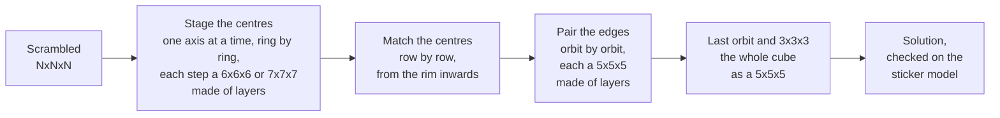

# How the solvers work

The README has the short version; this is the detail, size by size.

Every solver here is a reduction solver: it turns the cube into a smaller
problem in a few phases, and each phase is searched with exact lookup tables
where they fit in memory. Three things keep the solutions short:

- **Phases are joined** where the tables allow it, so that one search does
  what two did.
- **Many candidates are kept, not one.** Each phase starts from every result
  of the phase before, and the shortest total wins, not the shortest phase.
- **Every symmetry is used**: the cube may end in any orientation and the
  phases may run along any axis.

## Any size (`src/nnn.rs`)

Some layers of a large cube, taken together, behave like a small cube: pick
a few of them symmetrically and let every layer in between follow the picked
layer next to it towards the middle. Whatever is solved in such a block of
layers stays solved when the small cube is solved, so a large cube can be
done as a sequence of small ones.

- Centres: staged one axis at a time, ring by ring from the middle
  outwards. The rows of a ring are first made each of one kind (all of
  the axis or none), two mirror orbits of oblique centres at a time, each
  step a 6x6x6 or a 7x7x7 made of layers (with the staging of those
  solvers); then the whole ring goes onto its faces in one step, as the x
  and t centres of a 5x5x5. Then, row by row from the rim inwards, every
  centre is made to agree in colour with the one under it
  (`src/rings.rs`); the edge steps bring them home. A short row (up to
  five centres: the last row of every cube, and the one before it on an
  odd cube) is matched with all its columns at once: a beam search for
  each of the eight ways the row may agree, a level at a time side by
  side, and from the states with one or two pairs of centres left an exact
  search of the last few moves, which the score of the beam cannot see.
  A long row is matched from its middle
  outwards, the columns done so far kept alike so that each step is a
  search of the same small size whatever the length of the row. Should no
  matching be found, the centres are brought home one step at a time
  instead (`src/axes.rs`).
- Edges: orbit by orbit from the middle outwards, each a 5x5x5 whose middle
  edges are the stretch already joined (a 4x4x4 for the innermost wings of
  an even cube). The last one is the whole cube as a 5x5x5, solved to the end.

The same code runs every size from 6 up; nothing in it knows the size.

## 3x3x3 (`src/two3.rs`, `src/first3.rs`, `src/opt3.rs`)

Kociemba's two-phase algorithm. The first phase brings the cube into the
subgroup that `U D R2 L2 F2 B2` generate (no edge flipped, no corner
twisted, the four slice edges in their slice); the second solves it with
those moves alone.

- **The first phase is taken by length.** Every way into the subgroup of up
  to 14 moves is tried (12 in `--mode fast`), along each of the three axes,
  for the cube and for its inverse: nine million ways for a cube in the
  default mode. A solution of 18 moves is found when one of them leaves at
  most four moves of the second phase.
- **A way costs a few table entries.** The search follows the exact
  distance to the subgroup, so it never enters a dead end. That table has
  one row per class of positions under the sixteen symmetries that keep the
  U/D axis (35 MB; 554 MB without them). For the 850 thousand positions
  within 7 moves of the subgroup the file also holds every shortest way,
  written out: once a position is as far away as there are moves left, its
  ways are read from that list. Such positions are looked up 64 at a time,
  so that the waits for memory overlap. The 8 million positions one move
  further out have the moves that lead nearer listed.
- **Most ways are turned away by the corners.** The corners' permutation
  is carried along, and the moves of the second phase it needs by itself
  are in a small table. Only for the few ways that pass is the cube put
  together and the second phase searched, with a table of the exact moves
  for corners and U/D edges together.
- The search runs on all cores and its answer does not depend on how the
  work falls on them.
- **`--mode full` is optimal.** It starts from the two-phase solution and
  searches every shorter length completely (`src/opt3.rs`), with the exact
  distance, along each axis, to the smaller subgroup in which the slice
  edges are also in place (1.7 GB). Showing that nothing shorter exists
  takes a fraction of the time of finding a solution of that length, so a
  good two-phase solution is most of the work.

Every larger cube ends as a 3x3x3, many times over: its solver keeps
hundreds of reduced cubes and wants the shortest total. All of them get a
search with a short first phase, then the ones with the shortest totals a
longer one, step by step, each only for a solution that would not make the
best total longer (`Two3::finish`).

On one core in the browser (WebAssembly) the older search of `src/c3.rs`
runs instead: it stops after a number of second phases.

## 4x4x4

The phase structure started from Chen Shuang's
[TPR solver](https://github.com/cs0x7f/TPR-4x4x4-Solver) (itself based on
Tsai's 8-step method) and now has three stages:

1. **Joint phase** (all moves): stage every centre on a face of its own axis,
   bring the R/L centres into a pattern the next phase can finish, make the
   wing permutation even and the dedges pairable. This replaces TPR's phases
   1 and 2. An exact table over all 9.47 billion centre states makes the centre
   part of the search perfect. The last move is tested against the wings
   first, which rejects almost all of them without looking at the centres.
2. **Phase 3** (`U D F B R2 L2 Uw2 Rw2 Fw2`): pair the 12 dedges and solve the
   centres, as in TPR, with an exact table of the pairing permutation.
3. **3x3x3**: Kociemba's two-phase algorithm on the reduced cube, with an exact
   table for its first phase.

What keeps the solutions short:

- Phases 1 and 2 of TPR are searched as one phase (about 1.2 moves).
- The solver collects thousands of joint-phase endpoints and many reductions,
  and the 3x3x3 stage picks the reduction with the shortest total (about 2
  moves). The most promising reductions get a much deeper 3x3x3 search.
- The cube has no fixed centres, so it may end in any of 24 orientations and
  the phases may run along any of 3 axes. All 18 distinct combinations are
  tried; one search serves the three axes.

## 5x5x5

- Centres (`src/stage5.rs`): the R/L centres go to the R and L faces with all
  36 moves, then an exact table puts the U/D and F/B centres on their axes.
  Staging all centres in one step (`src/centres5.rs`) is exact and shorter,
  15 moves against 17 on the one cube measured, but took 340 s for it.
- Edges (`src/edges5.rs`), three phases:
  - C: every pair of wings gets one wing in each half of the wing positions,
    matching the flip of its middle edge (face turns and wide half turns);
  - P: four whole edges are built in the middle slice (F and B freely, half
    turns elsewhere), with an exact table for the twelve pieces involved and
    tables of those pieces against the centres;
  - E: the other eight edges and all centres (U and D freely, half turns
    elsewhere), with an exact pairing table.
- The 3x3x3 that is left is solved for many reduced cubes; the shortest total
  wins.
- Each step starts from every result of the step before and keeps the
  continuations that are shortest in total (`src/solver5.rs`). The edge phases
  see the cube from six sides: three choices of axis, two of the slice.

## 6x6x6 and 7x7x7

How they work, what was tried and the per-step lengths are in
`bench/RESULTS.md` (sources: `src/stage6.rs`, `src/solver6.rs`,
`src/stage7.rs`, `src/solver7.rs`, `src/search.rs`).

## Verification

Every solution is applied to the full cube model and checked before it is
returned. Beyond that:

- The 4x4x4 model gives the same facelets as TPR for every benchmark
  scramble, and TPR's solutions solve the cube in this model.
- The any-size sticker model (`src/cuben.rs`), built from geometry alone,
  agrees with the 4x4x4 model move for move.
- The 2x2x2 table reproduces the known distance distribution (maximum 11).
- The 3x3x3 domino table reproduces Kociemba's published distribution.
- The shared joint search finds the same endpoints as an unshared one.
